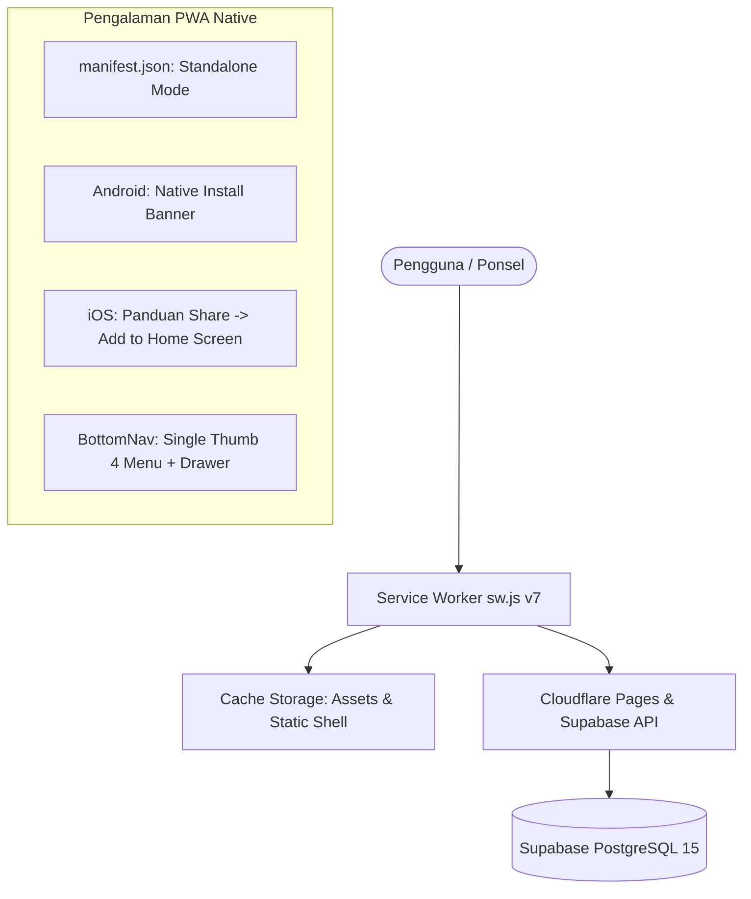
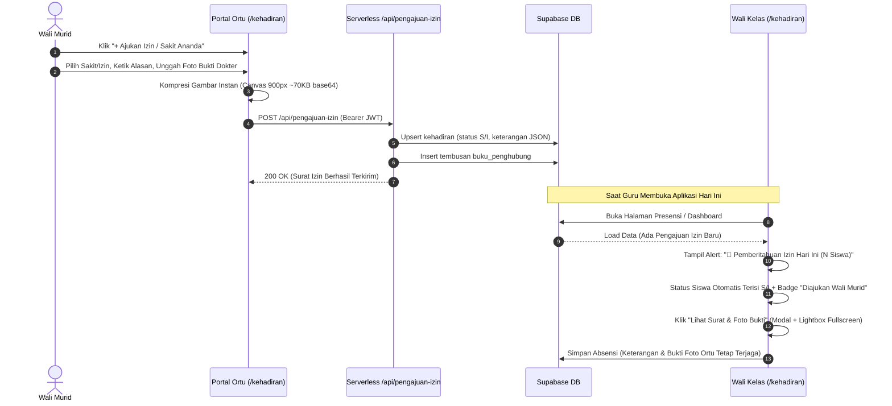
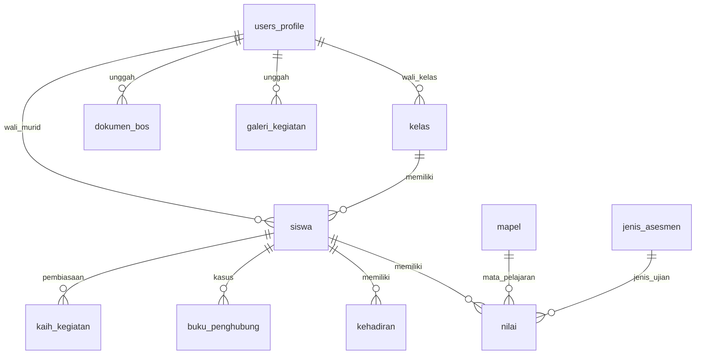

# PRD — LAPIS LADA v2.5
**Layanan Pusat Informasi Sekolah Latsari Dua**
Versi Dokumen: 2.5 (Revisi Final & Implementasi Penuh) · Status: **Production Ready / Implemented**  
Institusi: **UPT SD Negeri Latsari 2 Bancar, Tuban, Jawa Timur**  
Domain Resmi: [https://lapislada.web.id](https://lapislada.web.id)  
Repositori: [https://github.com/jfmprinting/lapislada.git](https://github.com/jfmprinting/lapislada.git) (Branch `main`)  
Tanggal Pembaruan: 21 Oktober 2026  

---

## 1. Ringkasan Eksekutif & Identitas Produk

**LAPIS LADA** (*Layanan Pusat Informasi Sekolah Latsari Dua*) adalah platform terpadu komunikasi, administrasi akademik, dan pelayanan transparansi sekolah dasar berbasis **Next.js 16 (App Router + Turbopack)** dan **Supabase Cloud (PostgreSQL 15 + Auth + RLS)**.

Sistem ini diciptakan khusus untuk **UPT SD Negeri Latsari 2 Bancar, Tuban** guna menggantikan buku penghubung fisik, tumpukan berkas administrasi kertas, serta percakapan WhatsApp paguyuban yang sering tercecer menjadi **satu pintu kendali digital** yang cepat, akurat, dan hemat biaya.

```
       ┌─────────────────────────────────────────────────────────────┐
       │                         LAPIS LADA                          │
       │        Layanan Pusat Informasi Sekolah Latsari Dua          │
       ├──────────────────────────────┬──────────────────────────────┤
       │     Pilar 01: Satu Pintu     │    Pilar 02: Transparansi    │
       │  Pusat pengumuman & layanan  │  Data BOS, profil & galeri   │
       ├──────────────────────────────┼──────────────────────────────┤
       │     Pilar 03: Interaktif     │    Pilar 04: Digitalisasi    │
       │  Buku penghubung & izin ortu │  Presensi, leger & 7 KAIH    │
       └──────────────────────────────┴──────────────────────────────┘
```

### 1.1. Spesifikasi Stack Teknologi

| Komponen | Teknologi | Keterangan Implementasi |
|---|---|---|
| **Frontend Framework** | **Next.js 16.3.5** (React 19 / TypeScript) | Menggunakan App Router, Suspense boundaries, dan kompilasi instan Turbopack. |
| **Styling & Design System** | **Tailwind CSS v4** + Vanilla CSS Variables | Palet khas identitas sekolah merah marun `#922B21`, aksen terakota `#C0392B`, latar krem `#F5F0E8`. |
| **Tipografi** | **Lora** (Display / Serif) & **Plus Jakarta Sans** (UI / Body) | Dimuat melalui `next/font/google` dengan fallback native system. |
| **Database & Auth** | **Supabase Cloud** (PostgreSQL 15) | Database real-time, Row Level Security (RLS) ketat, Supabase Auth dengan custom triggers. |
| **Hosting & Edge Functions** | **Cloudflare Pages** + Pages Functions | Static HTML export (`out/`) dengan serverless endpoint `/functions/api/*` untuk produksi. |
| **Penyimpanan Berkas Besar** | **Google Drive Integration** | Zero server storage cost. Dokumen BOS dan materi ajar disimpan via tautan resmi Google Drive. |
| **Penyimpanan Media Ringan** | **Client-Side Canvas Compression** | Foto kegiatan 7 KAIH, galeri, dan surat izin dokter dikompresi otomatis di browser (~60–90 KB WebP/JPEG). |
| **Progressive Web App (PWA)** | **Service Worker v7 (`sw.js`) + Manifest** | Dukungan offline, auto-update cache, standalone display, banner instalasi Android & modal instruksi iOS Safari. |
| **Notifikasi & Siaran** | **In-App Alerts + WhatsApp Direct Dispatch** | Banner notifikasi realtime di portal guru, badge belum dibaca, dan tombol kirim WhatsApp (`wa.me/62...`) berformat resmi. |
| **Keamanan Sistem** | **OWASP Top 10 Hardened** | Proteksi brute-force login (5x gagal -> cooldown 60s), RBAC token-based, dan pembersihan residu plaintext. |

---

## 2. Prinsip Desain & Standar Antarmuka

### 2.1. Mobile-First (Viewport Utama: 390px)
Mayoritas wali murid dan dewan guru mengakses LAPIS LADA melalui ponsel pintar (*smartphone*). Seluruh antarmuka dirancang pertama kali untuk layar sempit (390px – 430px) dengan prinsip:
- *Single-Thumb Ergonomics*: Tombol aksi utama, drawer menu, dan tab navigasi mudah dijangkau satu jempol tangan.
- *Anti-Clutter Visual*: Menghindari tabel data yang terlalu padat di layar ponsel. Digunakan kartu-kartu ringkas (*Action Cards / Bento Grid*) dengan kontras ramah mata.
- *Descender Clearance*: Jarak baris dan padding vertikal lega mencegah teks bertumpuk.

### 2.2. Panduan Warna Resmi Sekolah

| Token CSS | Hex Code | Peruntukan & Contoh Komponen |
|---|---|---|
| `--red-deep` | `#922B21` | Warna primer identitas sekolah, Navbar, header kartu eksekutif, tombol utama |
| `--red` | `#C0392B` | Aksen penekanan, tombol aksi primer, indikator status aktif |
| `--red-light` | `#F1948A` | Garis tepi (*border*) kartu aktif, badge status sekunder |
| `--red-pale` | `#FDEDEC` | Latar belakang (*background*) highlight, kartu notifikasi penting, banner peringatan |
| `--sand` | `#F5F0E8` | Latar belakang kanvas aplikasi (*body background*), hangat dan tidak silau |
| `--sand-mid` | `#E8E0D0` | Garis pembatas halus (*divider*), latar kartu netral |
| `--ink` | `#1A1A1A` | Teks judul utama, angka metrik tebal, keterbacaan tinggi |
| `--ink-mid` | `#3D3D3D` | Teks paragraf, label formulir, deskripsi fitur |
| `--muted` | `#6B6B6B` | Teks keterangan bantuan, timestamp, placeholder input |
| `--border` | `#DDD8CE` | Border baku seluruh kartu, modal, dan kolom tabel |
| `--white` | `#FFFFFF` | Latar kartu utama, modal dialog, formulir input |

### 2.3. Skala Radius Komponen
- **Kecil (`rounded-lg` / 8px)**: Badge status presensi (`[H]`, `[S]`, `[I]`, `[A]`), tag filter kategori.
- **Sedang (`rounded-xl` / 12px)**: Tombol aksi utama, formulir input teks, dropdown filter.
- **Besar (`rounded-2xl` / 16px)**: Kartu metrik KPI, kartu feed komunikasi, modal konfirmasi.
- **Ekstra Besar (`rounded-3xl` / 24px)**: Banner hero dashboard, card showcase halaman utama.

---

## 3. Arsitektur Progressive Web App (PWA) & Mobile UX

LAPIS LADA berfungsi layaknya aplikasi native tanpa membebani pengguna untuk mengunduh berkas ratusan megabyte dari Google Play Store atau Apple App Store.



### 3.1. Spesifikasi Service Worker (`public/sw.js` — Cache v7)
- **Strategi Navigasi**: *Network-First with Cache Fallback*. Memastikan konten dokumen HTML selalu teranyar saat ada koneksi internet, namun tetap menampilkan halaman tersimpan saat koneksi terputus.
- **Strategi Aset Statis**: *Cache-First* untuk gambar logo (`/logo.webp`), berkas font, dan manifest.
- **Bypass Rule**: Kueri API Supabase (`*.supabase.co`), rute serverless (`/api/*`), dan chunk dinamis Next.js tidak disimpan di cache untuk menjamin integritas data real-time.

### 3.2. Solusi Navigasi Ponsel Bersih (Single Drawer Navigation)
Menghilangkan bug *double hamburger menu* lama:
- Header atas mobile dibuat minimalis dan tenang (hanya menampilkan logo dan identitas sekolah).
- Bilah navigasi bawah (*BottomNav*) memuat 4 tab cepat + tombol pemicu **"Menu"** di pojok kanan bawah yang membuka laci samping (*Sidebar Drawer*) lengkap dengan seluruh menu modul, pintasan profil, dan tombol instalasi PWA.

---

## 4. Peran Pengguna (Roles & Permissions Matrix)

Sistem memberlakukan **Role-Based Access Control (RBAC)** berbasis Supabase Auth dan PostgreSQL RLS:

| Fitur / Modul | Wali Murid (`orangtua`) | Guru / Wali Kelas (`guru`) | Kepala Sekolah (`kepala_sekolah`) | Administrator (`admin`) |
|---|:---:|:---:|:---:|:---:|
| **Dashboard Khusus** | ✅ Dashboard Ortu | ✅ Dashboard Guru | ✅ Dashboard Eksekutif | ✅ Dashboard Admin |
| **Presensi Harian** | ❌ (Hanya Ajukan Izin) | ✅ Input & Verifikasi | 👁️ Monitoring Read-Only | ✅ Kelola Penuh |
| **Rekap Presensi & Excel** | 👁️ Rekap Ananda | ✅ Cetak & Ekspor Rombel | ✅ Cetak & Ekspor Seluruh Kelas | ✅ Kelola Penuh |
| **Pengajuan Izin Mandiri** | ✅ Kirim Alasan + Foto | 👁️ Verifikasi & Setujui | 👁️ Pantau Riwayat Izin | 👁️ Pantau Seluruh Data |
| **Buku Penghubung** | ✅ Tulis & Baca (Anak) | ✅ Tulis, Edit, Hapus, Cetak Rombel | 👁️ Baca Seluruh Rombel & Cetak | ✅ Kelola Penuh |
| **Kirim Respon via WA** | ❌ | ✅ Generator WA Resmi | ✅ Generator WA Resmi | ✅ Generator WA Resmi |
| **Penilaian & Asesmen** | 👁️ Nilai Dipublikasi | ✅ Input Formatif/Sumatif | 👁️ Pantau Leger Nilai | ✅ Kelola Penuh |
| **Karakter 7 KAIH** | ✅ Catat Rumah + Foto | ✅ Catat Kelas + Apresiasi | 👁️ Pantau 7 KAIH Global | ✅ Kelola Penuh |
| **Gamifikasi Kebun KAIH**| ✅ Siram Tanaman Ananda | 👁️ Pantau Hutan Kelas | 👁️ Pantau Hutan Sekolah | 👁️ Pantau Hutan Sekolah |
| **Materi Google Drive** | 👁️ Akses Materi Ananda | ✅ Tambah & Edit Link | 👁️ Akses Materi | ✅ Kelola Penuh |
| **Dokumen BOS** | 👁️ Mode Transparansi | ✅ Kelola SPJ & RKAS | ✅ Pantau Seluruh Arsip | ✅ Kelola Penuh |
| **Pengumuman** | 👁️ Baca Pengumuman | ✅ Terbitkan Pengumuman | ✅ Terbitkan Pengumuman | ✅ Kelola Penuh |
| **Galeri Dokumentasi** | 👁️ Lihat & Bagikan | 👁️ Lihat & Bagikan | 👁️ Lihat & Bagikan | ✅ Kelola & Upload |
| **Master Data (Siswa/Guru)**| ❌ | ❌ | 👁️ Data Guru & Siswa | ✅ CRUD & Reset Akun |
| **Profil Sekolah Publik** | 👁️ Tampilan Publik | 👁️ Tampilan Publik | 👁️ Tampilan Publik | ✅ Edit Identitas Lembaga |

---

## 5. Rincian Modul & Fitur Terimplementasi (Sesuai Kode Produksi)

### 5.1. Modul 01 — Kehadiran Siswa, Rekap Bulanan & Pengajuan Izin Satu Pintu

**Lokasi Berkas**: [`src/app/kehadiran/page.tsx`](file:///d:/1.%20MIZTERGOOD/04%20-%20Keuangan%20dan%20Bisnis/JASA/11.%20PAK%20SANS/1.%20LAPIS%20LADA/src/app/kehadiran/page.tsx) · [`src/app/api/pengajuan-izin/route.ts`](file:///d:/1.%20MIZTERGOOD/04%20-%20Keuangan%20dan%20Bisnis/JASA/11.%20PAK%20SANS/1.%20LAPIS%20LADA/src/app/api/pengajuan-izin/route.ts) · [`functions/api/pengajuan-izin.ts`](file:///d:/1.%20MIZTERGOOD/04%20-%20Keuangan%20dan%20Bisnis/JASA/11.%20PAK%20SANS/1.%20LAPIS%20LADA/functions/api/pengajuan-izin.ts)



**Fitur Utama:**
1. **Absensi Harian Cepat**:
   - Pilihan tanggal dan rombel belajar.
   - Quick counter harian (Hadir, Sakit, Izin, Alpha).
   - Tombol instan `✓ Tandai Semua Hadir` untuk efisiensi waktu guru di pagi hari.
   - Preservasi data: Menyimpan presensi tidak akan menghapus data foto surat izin kiriman orang tua.
2. **Rekap Kehadiran Bulanan & Laporan Kedinasan**:
   - Filter Kelas, Bulan kalender (Januari s/d Desember), dan Tahun.
   - **Mode Ringkasan**: Tabel rekapitulasi total H, S, I, A, jumlah hari efektif, persentase kehadiran (%), dan indikator status disiplin.
   - **Mode Grid Matriks 1–31**: Kisi-kisi presensi tanggal 1 sampai akhir bulan dengan penandaan hari Minggu/libur.
   - **Kartu Metrik KPI Rombel**: Menghitung persentase kehadiran rata-rata rombel secara dinamis.
   - **Ekspor Excel (`.xlsx`)**: Dihasilkan via pustaka SheetJS berformat resmi dinas pendidikan.
   - **Cetak Laporan Resmi**: Format cetak standar dinas lengkap dengan Kop Surat Resmi UPT SD Negeri Latsari 2 Bancar serta kolom tanda tangan Kepala Sekolah (*Santoso ,S.Pd.,M.Pd.*) dan Wali Kelas.
3. **Pengajuan Izin Satu Pintu (Fitur Terbaru 21 Oktober 2026)**:
   - Formulir mandiri di portal orang tua dengan input tanggal, radio Sakit vs Izin, alasan tertulis, dan unggah foto surat keterangan dokter.
   - Menggunakan kompresi gambar HTML5 Canvas di browser tanpa membebani kuota orang tua.
   - Data disimpan terstruktur dalam format JSON di kolom `kehadiran.keterangan` secara aman tanpa perlu migrasi DDL berisiko pada tabel aktif.
   - Tembusan otomatis ke `buku_penghubung` memastikan guru menerima peringatan dari dua modul sekaligus.
   - Notifikasi banner amber mencolok di Dashboard Guru dan tabel absensi harian.

---

### 5.2. Modul 02 — Nilai Siswa, Asesmen Kurikulum Merdeka & Publikasi Rapor

**Lokasi Berkas**: [`src/app/nilai/page.tsx`](file:///d:/1.%20MIZTERGOOD/04%20-%20Keuangan%20dan%20Bisnis/JASA/11.%20PAK%20SANS/1.%20LAPIS%20LADA/src/app/nilai/page.tsx) · [`src/app/admin/jenis-asesmen/page.tsx`](file:///d:/1.%20MIZTERGOOD/04%20-%20Keuangan%20dan%20Bisnis/JASA/11.%20PAK%20SANS/1.%20LAPIS%20LADA/src/app/admin/jenis-asesmen/page.tsx)

**Fitur Utama:**
1. **Master Jenis Asesmen Kurikulum Merdeka**:
   - Terintegrasi penuh dengan tabel `public.jenis_asesmen` di database cloud Supabase.
   - Mendukung Asesmen Formatif (Formatif Tujuan Pembelajaran FTP1, FTP2) dan Asesmen Sumatif (Sumatif Lingkup Materi SLM1, SLM2, Sumatif Tengah Semester STS, Sumatif Akhir Semester SAS).
   - Pengaturan urutan dan toggle aktif/non-aktif dari portal admin.
2. **Pencatatan & Leger Nilai**:
   - Filter Kelas, Mata Pelajaran, Semester, dan Tahun Ajaran.
   - Input nilai angka beserta kolom `catatan` perkembangan belajar siswa.
   - Skema composite unique constraint `(siswa_id, mapel_id, jenis_ujian, semester, tahun_ajaran)` dengan operasi upsert yang aman mencegah error duplicate key.
   - **Tab Leger Nilai**: Tabel komprehensif seluruh nilai mapel per siswa, kalkulasi rata-rata, predikat capaian, serta tombol ekspor/cetak leger sekolah.
3. **Mekanisme Publikasi Rapor (`is_published`)**:
   - Tombol sakelar (*toggle*) publikasi memungkinkan guru mengunci nilai sebagai draft internal terlebih dahulu.
   - Portal orang tua hanya menampilkan nilai dan catatan perkembangan yang statusnya telah resmi dipublikasikan (`is_published = true`).

---

### 5.3. Modul 03 — Buku Penghubung Kedinasan Dua Arah & Integrasi WhatsApp

**Lokasi Berkas**: [`src/app/buku-penghubung/page.tsx`](file:///d:/1.%20MIZTERGOOD/04%20-%20Keuangan%20dan%20Bisnis/JASA/11.%20PAK%20SANS/1.%20LAPIS%20LADA/src/app/buku-penghubung/page.tsx) · [`src/app/api/buku-penghubung/route.ts`](file:///d:/1.%20MIZTERGOOD/04%20-%20Keuangan%20dan%20Bisnis/JASA/11.%20PAK%20SANS/1.%20LAPIS%20LADA/src/app/api/buku-penghubung/route.ts)

```
┌────────────────────────────────────────────────────────────────────────────┐
│                    BUKU PENGHUBUNG GURU DAN ORANG TUA                      │
│                      UPT SD NEGERI LATSARI 2 BANCAR                        │
├────┬──────────┬─────────────────┬─────┬────────────┬──────────────┬────────┤
│ NO │ NIS/NISN │   NAMA SISWA    │ L/P │  TANGGAL   │   MASALAH    │ SARAN  │
├────┼──────────┼─────────────────┼─────┼────────────┼──────────────┼────────┤
│ 1  │  100234  │ Ahmad Maulana   │  L  │ 2026-10-18 │ Sakit flu    │ Istir..│
└────┴──────────┴─────────────────┴─────┴────────────┴──────────────┴────────┘
 Mengetahui, Kepala Sekolah                       Guru Kelas / Wali Kelas
 Santoso ,S.Pd.,M.Pd.                             Santoso, S.Pd., M.Pd.
 NIP. 19850612 201001 1 015                       NIP. 19850612 201001 1 015
```

**Fitur Utama:**
1. **Adaptasi Format Fisik Kedinasan Resmi**:
   - Tabel dinas mencakup: *Nomor Urut • Nomor Induk (NIS) • Nama Siswa • Jenis Kelamin (L/P) • Tanggal Kejadian • Masalah yang Disampaikan • Saran dan Kesimpulan • Respon / Konfirmasi*.
   - Standar cetak dinas (`window.print()`) dengan kop resmi sekolah dan kolom tanda tangan Kepala Sekolah & Wali Kelas.
2. **Filterisasi Kelas & Siswa Ketat**:
   - Guru wali kelas hanya melihat siswa di rombel binaannya (contoh: 17 siswa Kelas I).
   - Dropdown filter perorangan siswa untuk memfokuskan telaah kasus siswa tertentu atau mencetak lembar buku penghubung individual saat sesi konsultasi wali murid.
3. **Tab Model Absensi (Aksi Cepat Langsung)**:
   - Tab daftar siswa menyajikan seluruh nama siswa di kelas beserta status nomor WhatsApp orang tua dan tombol pintas catat kejadian.
4. **Edit & Hapus Catatan Aman**:
   - Dialog modal konfirmasi hapus menampilkan cuplikan teks kejadian untuk menghindari salah hapus.
   - Didukung endpoint backend serverless (`/api/buku-penghubung`) berbasis Service Role.
5. **Integrasi WhatsApp Satu Klik**:
   - Template pesan resmi disusun otomatis menghubungkan nomor handphone orang tua yang tercatat (`https://wa.me/62...`).
   - Tautan balasan di pesan WA distandarkan langsung ke `https://lapislada.web.id/buku-penghubung`.

---

### 5.4. Modul 04 — Dashboard Terpadu Multi-Role

LAPIS LADA memiliki 3 antarmuka beranda yang dipersonalisasi sesuai kebutuhan masing-masing peran:

1. **Dashboard Guru & Admin (`/dashboard`)**:
   - Peringatan belum input presensi hari ini.
   - Kartu notifikasi pengajuan izin masuk hari ini (*Today's Leave Alerts*).
   - Feed buku penghubung yang belum dibaca (*Unread Counter*).
   - Menu aksi cepat: Absen, Nilai, Pengumuman, Materi, BOS, KAIH.
2. **Dashboard Orang Tua (`/dashboard/orangtua`)**:
   - Identitas ananda yang dipantau (nama lengkap, kelas, NISN).
   - Widget kehadiran bulan ini + tombol cepat `+ Ajukan Izin / Sakit Ananda ke Wali Kelas`.
   - Ringkasan pembiasaan Karakter 7 KAIH hari ini + tombol `+ Catat & Foto Bukti`.
   - Feed buku penghubung dua arah dari guru kelas.
   - Ringkasan pengumuman sekolah & transparansi laporan Dana BOS.
3. **Dashboard Eksekutif Kepala Sekolah (`/dashboard/kepala-sekolah`)**:
   - Monitoring live kedisiplinan pengisian absensi seluruh rombel (Kelas I s/d VI).
   - Status administrasi per rombel: `Sudah Input` vs `Menunggu Guru`.
   - 4 Kartu KPI Utama: Kehadiran Global Sekolah (%), Total Siswa Aktif, Jumlah Dewan Guru & Staf PTK, dan Total Rekam 7 KAIH Hari Ini.
   - Mode *Read-Only Aman* untuk pengawasan dan supervisi manajerial.

---

### 5.5. Modul 05 — Karakter 7 KAIH (Warisan ABAT) & Gamifikasi Kebun Karakter

**Lokasi Berkas**: [`src/app/kaih/page.tsx`](file:///d:/1.%20MIZTERGOOD/04%20-%20Keuangan%20dan%20Bisnis/JASA/11.%20PAK%20SANS/1.%20LAPIS%20LADA/src/app/kaih/page.tsx) · [`src/components/kaih/KaihGarden.tsx`](file:///d:/1.%20MIZTERGOOD/04%20-%20Keuangan%20dan%20Bisnis/JASA/11.%20PAK%20SANS/1.%20LAPIS%20LADA/src/components/kaih/KaihGarden.tsx)

```
        7 PILAR PEMBIASAAN KARAKTER ANAK INDONESIA HEBAT (ABAT)
 1. 🌅 Bangun Pagi & Rapikan Tempat Tidur     5. 🥗 Makan Makanan Bergizi Seimbang
 2. 🕌 Beribadah Tepat Waktu                  6. 🤝 Bermasyarakat & Bantu Ortu
 3. 🏃 Berolahraga / Aktivitas Fisik          7. 🌙 Tidur Cepat Tepat Waktu (≤ 21.00)
 4. 📚 Gemar Belajar & Membaca Buku
```

**Fitur Utama:**
1. **Pencatatan Karakter Dua Arah**:
   - **Guru di Sekolah**: Mencatat kegiatan pembiasaan global kelas per hari (contoh: Sholat Dhuha bersama, Senam Pagi, Literasi Pojok Baca) lengkap dengan jam dan foto dokumentasi.
   - **Orang Tua di Rumah**: Mencatat 1–2 pembiasaan baik ananda di rumah sepulang sekolah (contoh: merapikan kamar, mengaji maghrib, istirahat tepat waktu) dilengkapi tombol kamera HP langsung.
2. **Kompresi Foto Otomatis & Retensi 30 Hari**:
   - Kompresi canvas sisi klien menghasilkan foto WebP/JPEG ringan (~80 KB) yang hemat kuota dan tidak membebani server.
   - *Banner Peringatan Retensi 30 Hari* dengan hitung mundur sisa hari masa simpan dan tombol **"Cadangkan / Ekspor Data"** (ekspor file JSON arsip kegiatan & foto ke komputer).
3. **Apresiasi Guru (Dua Arah)**:
   - Guru wali kelas dapat memeriksa foto kegiatan rumah siswa dan memberikan tombol **Apresiasi 👍** yang langsung memunculkan lencana bintang kebanggaan di portal orang tua.
4. **Gamifikasi Kebun Karakter 7 Pilar (`KaihGarden.tsx`)**:
   - Visualisasi kebun dan tanaman karakter ananda berbasis perolehan poin kebiasaan positif.
   - Visual 3D clay ramah anak dengan level perkembangan: Benih ➔ Tunas ➔ Pohon Rindang Berbuah.
   - Fitur "Hutan Karakter Kelas" yang memadukan pertumbuhan tanaman seluruh siswa dalam satu rombel.

---

### 5.6. Modul 06 — Pengumuman Sekolah & Kelas

**Lokasi Berkas**: [`src/app/pengumuman/page.tsx`](file:///d:/1.%20MIZTERGOOD/04%20-%20Keuangan%20dan%20Bisnis/JASA/11.%20PAK%20SANS/1.%20LAPIS%20LADA/src/app/pengumuman/page.tsx)

**Fitur Utama:**
- Publikasi pengumuman resmi sekolah yang tersimpan 100% full-cloud di Supabase `public.pengumuman`.
- Segmentasi target audiens: `semua`, `guru`, atau `orangtua`.
- Pengumuman penting tingkat sekolah atau pengumuman khusus rombel agar informasi penting tidak lagi tenggelam di grup chat WhatsApp.

---

### 5.7. Modul 07 — Materi Pelajaran Google Drive

**Lokasi Berkas**: [`src/app/materi/page.tsx`](file:///d:/1.%20MIZTERGOOD/04%20-%20Keuangan%20dan%20Bisnis/JASA/11.%20PAK%20SANS/1.%20LAPIS%20LADA/src/app/materi/page.tsx)

**Fitur Utama:**
- Pengelolaan bahan ajar, modul Kurikulum Merdeka, bahan tayang presentasi, dan LKS tugas rumah.
- Guru menempelkan tautan resmi Google Drive (`drive.google.com`).
- *Zero Storage Cost*: Server tidak menyimpan berkas fisik, tautan langsung terbuka di peramban pengguna.
- Akses portal orang tua: Memungkinkan orang tua mendampingi ananda belajar dan mengulang materi dari rumah.

---

### 5.8. Modul 08 — Dokumen BOS & Transparansi Anggaran

**Lokasi Berkas**: [`src/app/dokumen-bos/page.tsx`](file:///d:/1.%20MIZTERGOOD/04%20-%20Keuangan%20dan%20Bisnis/JASA/11.%20PAK%20SANS/1.%20LAPIS%20LADA/src/app/dokumen-bos/page.tsx)

**Fitur Utama:**
- Pengarsipan terpusat dokumen Dana Bantuan Operasional Satuan Pendidikan (BOSP): SPJ, RKAS Perubahan, Laporan Realisasi, dan SK Tim Pengelola BOSP.
- Tersimpan di cloud Supabase `public.dokumen_bos` dengan tautan file Google Drive resmi.
- Filter Tahun Anggaran dan Kategori Dokumen.
- Hak Kelola (CRUD) diberikan kepada Guru, Kepala Sekolah, dan Administrator.
- Mode Transparansi: Orang tua memiliki akses pandang (*read-only*) untuk menumbuhkan akuntabilitas publik pengelolaan dana bantuan sekolah.

---

### 5.9. Modul 09 — Galeri Dokumentasi Kegiatan Sekolah

**Lokasi Berkas**: [`src/app/galeri/page.tsx`](file:///d:/1.%20MIZTERGOOD/04%20-%20Keuangan%20dan%20Bisnis/JASA/11.%20PAK%20SANS/1.%20LAPIS%20LADA/src/app/galeri/page.tsx) · [`src/app/admin/galeri/page.tsx`](file:///d:/1.%20MIZTERGOOD/04%20-%20Keuangan%20dan%20Bisnis/JASA/11.%20PAK%20SANS/1.%20LAPIS%20LADA/src/app/admin/galeri/page.tsx)

**Fitur Utama:**
- Tersimpan 100% full-cloud di tabel `public.galeri_kegiatan`.
- Kategori dokumentasi: Upacara & Nasionalisme, Pramuka & Ekskul, Keagamaan & Karakter, Akademik & Literasi.
- Modal *Lightbox Fullscreen* pratinjau foto resolusi jernih.
- Tombol bagikan ke WhatsApp dengan deskripsi kegiatan dan tautan resmi `https://lapislada.web.id/galeri`.
- Antarmuka manajemen admin untuk mengunggah foto baru, menyunting deskripsi, dan menghapus dokumentasi lama.

---

### 5.10. Modul 10 — Landing Page Publik & Standout Showcase LAPIS LADA

**Lokasi Berkas**: [`src/app/page.tsx`](file:///d:/1.%20MIZTERGOOD/04%20-%20Keuangan%20dan%20Bisnis/JASA/11.%20PAK%20SANS/1.%20LAPIS%20LADA/src/app/page.tsx)

**Fitur Utama:**
- Halaman beranda publik terbuka (`/`) tanpa kewajiban login.
- **Dedicated Showcase Section LAPIS LADA**: Terletak persis di bawah banner hero utama, menonjolkan makna singkatan, filosofi layanan, dan Bento Grid 4 Pilar Utama.
- **Profil Lembaga & Identitas**: NPSN (20504924), NSS, Akreditasi B, Tahun Berdiri 1987, dan Alamat lengkap Jl. Desa Latsari No.190 Bancar.
- **Visi & 9 Misi Sekolah**: Menampilkan visi dan sembilan poin misi resmi sekolah.
- **5 Indikator Target Tujuan Sekolah**: Menampilkan target ketercapaian religius, karakter, kolaborasi, kemandirian, dan prestasi.
- **Galeri Foto Terkini**: Menampilkan cuplikan dokumentasi kegiatan terbaru langsung dari Supabase.
- **Kontak & Peta Interaktif**: Nomor telepon sekolah, nomor handphone Kepala Sekolah, email resmi, dan sematan Google Maps.
- **Tombol CTA Langsung**: Pintasan login Portal Guru, Portal Orang Tua, dan Pengawasan Kepala Sekolah.

---

### 5.11. Modul 11 — Master Data & Administrasi Terpusat

1. **Master Siswa (`/admin/siswa`)**:
   - CRUD data siswa (NISN, NIS, Nama Lengkap, Jenis Kelamin, Kelas, Nama Wali, No HP Wali).
   - Fitur **Bulk Import Excel/CSV (`.xlsx`)**: Unggah puluhan data siswa sekaligus dengan pemetaan kolom otomatis.
   - Fitur **Reset Password & Akun Wali Murid**: Terhubung ke modal [ResetPasswordModal.tsx](file:///d:/1.%20MIZTERGOOD/04%20-%20Keuangan%20dan%20Bisnis/JASA/11.%20PAK%20SANS/1.%20LAPIS%20LADA/src/components/admin/ResetPasswordModal.tsx) untuk membuat/mereset akun Supabase Auth dan mengirim kredensial via pesan WhatsApp satu klik.
2. **Master Guru & PTK (`/admin/guru`)**:
   - Pengelolaan data tenaga pendidik, NIP, nomor telepon, dan status penugasan wali kelas.
3. **Master Kelas & Rombel (`/admin/kelas`)**:
   - Pengelolaan rombongan belajar (Kelas 1 s/d Kelas 6), tahun ajaran berjalan, dan penetapan guru wali kelas.
4. **Master Mata Pelajaran (`/admin/mapel`)**:
   - Pengelolaan daftar mata pelajaran wajib, muatan lokal (Bahasa Jawa), dan batas Kriteria Ketuntasan Minimal (KKM).
5. **Master Profil Sekolah (`/admin/profil-sekolah`)**:
   - Formulir pengubahan identitas sekolah publik yang tersimpan di `public.profil_sekolah`.

---

### 5.12. Modul 12 — Serverless API, Auto-Link Sinkronisasi & Keamanan OWASP

**Lokasi Berkas**: `/src/app/api/*` · `/functions/api/*`

1. **Auto-Link Sinkronisasi Siswa (`/api/link-siswa`)**:
   - Memecahkan kendala klasik RLS Supabase di mana akun orang tua baru belum tertaut ke kolom `siswa.wali_murid_id`.
   - Menggunakan master Service Role untuk memverifikasi JWT token orang tua, mencari data siswa berdasarkan NISN/ID/nama wali, dan memperbarui relasi secara permanen.
2. **Reset Akun Admin Terpadu (`/api/admin-reset-password`)**:
   - Membuat pengguna di Supabase Auth (`auth.users`), memperbarui `public.users_profile`, dan mengaitkan `siswa.wali_murid_id` secara atomik.
3. **Buku Penghubung Handler (`/api/buku-penghubung`)**:
   - Melayani permintaan `DELETE` dan `PATCH` untuk catatan buku penghubung dengan validasi otoritas.
4. **OWASP Top 10 Security Hardening**:
   - **A07 (Identification & Authentication Failures)**: Penangguhan akun (*lockout*) selama 60 detik jika gagal memasukkan kata sandi 5 kali berturut-turut.
   - **A01 (Broken Access Control)**: Enforcing RLS PostgreSQL di seluruh tabel Supabase.
   - **A04 (Insecure Design)**: Pembersihan otomatis residu penyimpanan kredensial plaintext lawas di `localStorage`.

---

## 6. ASCII Wireframe Lengkap (Mobile-First 390px)

Semua wireframe di bawah ini merefleksikan antarmuka aktual aplikasi pada lebar ponsel standar (390px).

---

### WF-01 · Landing Page Publik `/`

```
┌────────────────────────────────────────┐
│ 🏫 SDN Latsari 2 Bancar        [Masuk] │  ← navbar sticky, bg --red-deep
├────────────────────────────────────────┤
│  UPT SD NEGERI LATSARI 2 BANCAR        │  ← font-display Lora
│  Akreditasi B · NPSN 20504924 · Tuban  │
│                                        │
│  ┌──────────────┐  ┌──────────────┐    │
│  │ 👤 Portal    │  │ 👨‍🏫 Portal    │    │  ← CTA portal masuk
│  │    Ortu      │  │    Guru      │    │
│  └──────────────┘  └──────────────┘    │
├────────────────────────────────────────┤
│  ✨ INOVASI SISTEM INFORMASI TERPADU    │  ← badge standout
│  LAPIS LADA                            │
│  Layanan Pusat Informasi Sekolah       │
│  Latsari Dua                           │
│                                        │
│  ┌──────────────────────────────────┐  │  ← Bento grid 4 pilar
│  │ 📑 01. Pusat Informasi Satu Pintu │  │
│  ├──────────────────────────────────┤  │
│  │ 🛡️ 02. Transparansi Data BOS     │  │
│  ├──────────────────────────────────┤  │
│  │ 💬 03. Komunikasi Buku Penghubung│  │
│  ├──────────────────────────────────┤  │
│  │ ⚡ 04. Digitalisasi Presensi & Nil│  │
│  └──────────────────────────────────┘  │
├────────────────────────────────────────┤
│  Tab: [Profil] [Visi Misi] [Galeri]   │
│  NSS: 101050612003 · NIS: 100020       │
│  Jl. Desa Latsari No.190, Bancar, Tuban│
│  [ Sematan Google Maps ]               │
└────────────────────────────────────────┘
```

---

### WF-02 · Halaman Login `/login` (OWASP Protected)

```
┌────────────────────────────────────────┐
│               LAPIS LADA               │  ← logo & brand
│  Layanan Pusat Informasi Sekolah       │
├────────────────────────────────────────┤
│  Masuk ke Akun Anda                    │
│                                        │
│  Email / Akun Sekolah                  │
│  [ user@sdnlatsari.sch.id            ] │
│                                        │
│  Kata Sandi                            │
│  [ ••••••••••••••••             👁️ ]   │
│                                        │
│  [        Masuk ke Sistem →         ]  │  ← tombol primer --red-deep
│                                        │
│  🔒 Dilindungi proteksi anti brute-    │
│     force (5x percobaan gagal / 60 dt) │
│                                        │
│  Lupa akun? Hubungi Admin Sekolah      │
└────────────────────────────────────────┘
```

---

### WF-03 · Dashboard Guru `/dashboard`

```
┌────────────────────────────────────────┐
│ LAPIS LADA                   [🔔 2]   │  ← header clean
├────────────────────────────────────────┤
│  Selamat Pagi, Santoso, S.Pd., M.Pd.   │
│  Wali Kelas I · Rabu, 21 Okt 2026      │
├────────────────────────────────────────┤
│  ⚠️ STATUS ABSENSI HARI INI            │  ← alert card
│  Kelas I belum mengisi presensi pagi   │
│  [ Isi Absensi Kelas Sekarang → ]      │
├────────────────────────────────────────┤
│  📢 PEMBERITAHUAN IZIN HARI INI (1)    │  ← alert pengajuan izin ortu
│  Wali murid telah mengirim surat izin  │
│  • Shangga Ganendra (Sakit demam)      │
│  [ Periksa Presensi & Foto Bukti → ]   │
├────────────────────────────────────────┤
│  📓 Buku Penghubung Terbaru            │
│  • [Ortu] Suwarti: Mohon izin ananda...│
│  [ Buka Buku Penghubung → ]            │
├────────────────────────────────────────┤
│  Pintasan Cepat:                       │
│  ┌────────┐ ┌────────┐ ┌────────┐      │
│  │✅Presen│ │📊Nilai │ │📢Umum  │      │
│  └────────┘ └────────┘ └────────┘      │
│  ┌────────┐ ┌────────┐ ┌────────┐      │
│  │📁Materi│ │📁BOS   │ │🌟7 KAIH│      │
│  └────────┘ └────────┘ └────────┘      │
├────────────────────────────────────────┤
│  🏠 Beranda  |  ✅ Presensi  |  ☰ Menu │  ← bottom nav mobile
└────────────────────────────────────────┘
```

---

### WF-04 · Dashboard Orang Tua `/dashboard/orangtua`

```
┌────────────────────────────────────────┐
│ Portal Orang Tua            [🔔 1]     │
├────────────────────────────────────────┤
│  Halo, Ibu Suwarti 👋                  │
│  Memantau Ananda: SHANGGA GANENDRA     │
│  Kelas III · NISN 3179818378           │
├────────────────────────────────────────┤
│  📊 Kehadiran Bulan Ini (Okt 2026)     │
│  ┌──────┐ ┌──────┐ ┌──────┐ ┌──────┐   │
│  │  16  │ │   1  │ │   0  │ │   0  │   │
│  │ Hadir│ │Sakit │ │ Izin │ │Alpha │   │
│  └──────┘ └──────┘ └──────┘ └──────┘   │
│  [ + Ajukan Izin / Sakit Ananda ]      │  ← tombol izin mandiri
├────────────────────────────────────────┤
│  🌱 Karakter 7 KAIH Hari Ini           │
│  Status: 1 Pembiasaan Tercatat         │
│  [ + Catat & Foto Bukti Hari Ini ]     │
├────────────────────────────────────────┤
│  📓 Catatan Wali Kelas Terakhir        │
│  "Ananda Shangga sangat aktif dan..."  │
│  [ Balas / Buka Buku Penghubung → ]    │
├────────────────────────────────────────┤
│  🏠 Beranda  |  📓 Catatan  |  ☰ Menu  │
└────────────────────────────────────────┘
```

---

### WF-05 · Dashboard Eksekutif Kepala Sekolah `/dashboard/kepala-sekolah`

```
┌────────────────────────────────────────┐
│ Dashboard Eksekutif Kepala Sekolah     │
│ UPT SD Negeri Latsari 2 Bancar         │
├────────────────────────────────────────┤
│  Selamat Datang, Santoso ,S.Pd.,M.Pd.  │
│  Monitoring Supervisi & Kinerja Rombel │
├────────────────────────────────────────┤
│  ┌────────────────┬────────────────┐   │
│  │ 94% Kehadiran  │ 104 Total Siswa│   │
│  ├────────────────┼────────────────┤   │
│  │ 11 Guru & PTK  │ 8 Rekam 7 KAIH │   │
│  └────────────────┴────────────────┘   │
├────────────────────────────────────────┤
│  📋 Monitoring Presensi Harian Rombel  │
│  • Kelas I   : 17/17 Hadir [Sudah Input]│
│  • Kelas II  : 16/18 Hadir [Sudah Input]│
│  • Kelas III : Menunggu Guru [Belum]   │
│  • Kelas IV  : 15/15 Hadir [Sudah Input]│
├────────────────────────────────────────┤
│  Pintasan Monitoring (Read-Only):      │
│  [Presensi] [Leger Nilai] [Dokumen BOS]│
└────────────────────────────────────────┘
```

---

### WF-06 · Presensi Harian & Modal Pengajuan Izin Ortu `/kehadiran`

```
┌────────────────────────────────────────┐
│ ← Presensi Siswa          Rabu, 21 Okt │
│   Kelas III · 18 Siswa                 │
├────────────────────────────────────────┤
│  📢 Pemberitahuan Izin Hari Ini (1)    │
│  Wali murid telah mengirim surat izin  │
├────────────────────────────────────────┤
│  No  Nama Siswa           Status       │
│  1.  Ahmad Rizki          [H][S][I][A] │
│  2.  Shangga Ganendra     [H]●S [I][A] │  ← auto-selected S
│      🏷️ Diajukan Wali Murid            │
│      [ 👁️ Lihat Surat & Foto Bukti ]   │  ← trigger lightbox
│  3.  Zaskia Putri         [H][S][I][A] │
├────────────────────────────────────────┤
│  [ ✓ Tandai Semua Hadir ]              │
│  [ Simpan Absensi Kelas → ]            │
└────────────────────────────────────────┘

--- MODAL PENGAJUAN IZIN ORANG TUA ---
┌────────────────────────────────────────┐
│ 📝 Ajukan Izin / Sakit Ananda          │
├────────────────────────────────────────┤
│  Tanggal Izin: [ 2026-10-21 ]          │
│  Jenis: (●) Sakit      ( ) Izin Acara  │
│                                        │
│  Keterangan / Alasan:                  │
│  [ Ananda demam tinggi sejak semalam ] │
│                                        │
│  Foto Bukti / Surat Dokter:            │
│  [ 📷 Ambil Foto Kamera / Galeri HP  ] │
│  Preview: [ Gambar terkompresi ~70KB ] │
│                                        │
│  [ Batal ]       [ Kirim ke Guru → ]   │
└────────────────────────────────────────┘
```

---

### WF-07 · Rekap Kehadiran Bulanan & Grid 1–31 `/kehadiran`

```
┌────────────────────────────────────────┐
│ Rekap Presensi Bulanan                 │
│ Filter: [ Kelas I ▼ ] [ Oktober ▼ ]    │
│ Mode  : (●) Ringkasan   ( ) Matriks 1-31│
├────────────────────────────────────────┤
│  KPI Kelas I:                          │
│  Total Siswa: 17 · Kehadiran: 96.2%    │
├────────────────────────────────────────┤
│  No  Nama           H  S  I  A  Persen │
│  1.  Ahmad Maulana 20  1  0  0   95.2% │
│  2.  Citra Lestari 21  0  0  0  100.0% │
├────────────────────────────────────────┤
│  [ 📥 Ekspor Excel (.xlsx) ]           │
│  [ 🖨️ Cetak Format Kedinasan ]         │
└────────────────────────────────────────┘
```

---

### WF-08 · Buku Penghubung Format Kedinasan `/buku-penghubung`

```
┌────────────────────────────────────────┐
│ Buku Penghubung Guru & Wali Murid      │
│ Rombel: Kelas I (17 Siswa)             │
│ Tab: [Format Resmi] [Daftar Siswa] [Feed│
├────────────────────────────────────────┤
│  Filter Siswa: [ Semua Siswa (4) ▼ ]   │
│                                        │
│  ┌──────────────────────────────────┐  │
│  │ Ahmad Maulana · L · 18 Okt 2026  │  │
│  │ Masalah: Sakit demam saat jam ke-2│  │
│  │ Saran  : Istirahat di rumah & min│  │
│  │ Status : Dikonfirmasi Ortu ✅    │  │
│  │ [ 📲 WhatsApp ] [ ✏️ Edit ] [ 🗑️ ] │  │
│  └──────────────────────────────────┘  │
├────────────────────────────────────────┤
│  [ + Catat Kejadian Siswa Baru ]       │
│  [ 🖨️ Cetak Lembar Buku Penghubung ]   │
└────────────────────────────────────────┘
```

---

### WF-09 · Karakter 7 KAIH & Kebun Karakter `/kaih`

```
┌────────────────────────────────────────┐
│ Karakter 7 KAIH (Warisan ABAT)         │
│ Tab: [Sekolah] [Rumah] [Kebun Karakter]│
├────────────────────────────────────────┤
│  ⚠️ Masa Retensi Foto: Sisa 24 Hari    │
│  [ 💾 Cadangkan Data & Foto (JSON) ]   │
├────────────────────────────────────────┤
│  🌳 KEBUN KARAKTER ANANDA (GAMIFIKASI) │
│  Tanaman: 🌟 Pohon Budi Pekerti (Lv 3) │
│  XP Karakter: 340 / 500 XP             │
│  [ 💧 Siram Pohon dengan Pembiasaan ]  │
├────────────────────────────────────────┤
│  Linimasa Rumah (Ananda Hari Ini):     │
│  • 05.15 - Merapikan tempat tidur      │
│    [ Foto Bukti Terlampir ]            │
│    🏷️ Diberi Apresiasi Guru 👍         │
│                                        │
│  [ + Catat Pembiasaan & Foto Kamera ]  │
└────────────────────────────────────────┘
```

---

## 7. Skema Database Supabase PostgreSQL & Row Level Security (RLS)

Sistem menggunakan skema relasional PostgreSQL 15 dengan kebijakan RLS terintegrasi:



### 7.1. Struktur Tabel Inti

#### 1. `public.profil_sekolah`
Tabel singleton (1 baris data lembaga):
- `id` (UUID PK), `nama_sekolah` (TEXT), `npsn` (TEXT), `nss` (TEXT), `nis` (TEXT), `akreditasi` (TEXT), `tahun_berdiri` (INT), `alamat` (TEXT), `kecamatan` (TEXT), `kabupaten` (TEXT), `provinsi` (TEXT), `kode_pos` (TEXT), `telepon` (TEXT), `hp_kepsek` (TEXT), `email` (TEXT), `visi` (TEXT), `misi` (TEXT), `tujuan` (TEXT), `logo_url` (TEXT), `maps_embed_url` (TEXT), `updated_at` (TIMESTAMPTZ).
- *RLS*: Publik dapat membaca (`SELECT USING (true)`), penyuntingan hanya peran `admin`.

#### 2. `public.users_profile`
Tabel profil pengguna yang tersinkronisasi otomatis via trigger dari `auth.users`:
- `id` (UUID PK REFERENCES `auth.users(id)`), `nama` (TEXT), `role` (TEXT: `admin`, `guru`, `orangtua`, `kepala_sekolah`), `jabatan` (TEXT), `email` (TEXT), `telepon` (TEXT), `created_at` (TIMESTAMPTZ), `updated_at` (TIMESTAMPTZ).

#### 3. `public.kelas`
- `id` (UUID PK), `nama_kelas` (TEXT, misal 'Kelas 1', 'Kelas 4A'), `wali_kelas_id` (UUID FK `users_profile`), `tahun_ajaran` (TEXT, misal '2026/2027').

#### 4. `public.siswa`
- `id` (UUID PK), `nisn` (TEXT UNIQUE), `nis` (TEXT), `nama_lengkap` (TEXT), `jenis_kelamin` (TEXT: 'L' / 'P'), `kelas_id` (UUID FK `kelas`), `wali_murid_id` (UUID FK `users_profile`), `nama_wali` (TEXT), `no_hp_wali` (TEXT), `alamat` (TEXT).
- *RLS*: Guru dan Admin dapat melihat seluruh siswa; Orang tua hanya dapat melihat baris yang memiliki `wali_murid_id = auth.uid()`.

#### 5. `public.kehadiran`
- `id` (UUID PK), `siswa_id` (UUID FK `siswa`), `kelas_id` (UUID FK `kelas`), `tanggal` (DATE), `status` (TEXT: 'H', 'S', 'I', 'A'), `keterangan` (TEXT — mendukung string biasa dan stringified JSON untuk formulir izin orang tua: `{"alasan": "...", "foto_url": "data:image/webp;base64,...", "diajukan_oleh": "...", "tipe": "orangtua", "submitted_at": "..."}`), `recorded_by` (UUID FK `users_profile`).
- *Constraint*: `UNIQUE(siswa_id, tanggal)`.

#### 6. `public.nilai`
- `id` (UUID PK), `siswa_id` (UUID FK `siswa`), `mapel_id` (UUID FK `mapel`), `jenis_ujian` (TEXT), `nilai` (NUMERIC), `semester` (INT), `tahun_ajaran` (TEXT), `catatan` (TEXT), `is_published` (BOOLEAN DEFAULT false), `created_by` (UUID FK `users_profile`).
- *Constraint*: `UNIQUE(siswa_id, mapel_id, jenis_ujian, semester, tahun_ajaran)`.

#### 7. `public.jenis_asesmen`
- `id` (TEXT PK), `nama` (TEXT), `kategori` (TEXT: 'Formatif' / 'Sumatif'), `kode` (TEXT), `aktif` (BOOLEAN DEFAULT true), `urutan` (INT).

#### 8. `public.buku_penghubung`
- `id` (UUID PK), `siswa_id` (UUID FK `siswa`), `author_id` (UUID FK `users_profile`), `author_role` (TEXT: 'guru' / 'orangtua'), `catatan` (TEXT), `parent_entry_id` (UUID FK `buku_penghubung`), `is_read_by_guru` (BOOLEAN DEFAULT false), `created_at` (TIMESTAMPTZ).

#### 9. `public.kaih_kegiatan`
- `id` (TEXT/UUID PK), `tipe` (TEXT: 'sekolah' / 'rumah'), `kelas_id` (TEXT/UUID FK), `siswa_id` (TEXT/UUID FK NULL jika sekolah), `kategori_id` (INT 1-7), `kategori_nama` (TEXT), `judul` (TEXT), `deskripsi` (TEXT), `jam` (TEXT), `tanggal` (DATE), `foto_url` (TEXT Base64/Storage), `created_by` (UUID FK), `creator_nama` (TEXT), `apresiasi_guru` (BOOLEAN DEFAULT false), `catatan_guru` (TEXT).

#### 10. `public.dokumen_bos`
- `id` (UUID PK), `judul` (TEXT), `kategori` (TEXT: 'SPJ', 'RKAS', 'Laporan', 'SK'), `link_gdrive` (TEXT), `tahun_anggaran` (INT), `triwulan` (INT 1-4), `uploaded_by` (UUID FK), `created_at` (TIMESTAMPTZ).

#### 11. `public.galeri_kegiatan`
- `id` (TEXT/UUID PK), `judul` (TEXT), `kategori` (TEXT), `tanggal` (DATE), `foto_url` (TEXT), `deskripsi` (TEXT), `created_by` (UUID FK).

#### 12. `public.pengumuman`
- `id` (UUID PK), `judul` (TEXT), `konten` (TEXT), `kelas_id` (UUID FK NULL jika sekolah), `target_role` (TEXT: 'semua', 'guru', 'orangtua'), `created_by` (UUID FK).

#### 13. `public.materi`
- `id` (UUID PK), `judul` (TEXT), `deskripsi` (TEXT), `kelas_id` (UUID FK), `mapel_id` (UUID FK), `link_gdrive` (TEXT), `created_by` (UUID FK).

---

## 8. Matriks Halaman & Routing URL Produksi

Seluruh 28 rute terkompilasi sukses dalam build produksi (`npm run build`):

| Path / URL | Hak Akses | Deskripsi & Fungsi Halaman |
|---|---|---|
| `/` | Publik | Profil lembaga, visi misi, dedicated showcase LAPIS LADA, galeri, kontak |
| `/login` | Publik | Halaman login multi-role dengan sistem perlindungan brute force |
| `/dashboard` | Guru, Admin | Beranda guru: alert absensi, alert izin masuk, unread counter buku penghubung |
| `/dashboard/orangtua` | Wali Murid | Beranda ortu: kartu ananda, kehadiran, 7 KAIH, buku penghubung, dokumen BOS |
| `/dashboard/kepala-sekolah`| Kepala Sekolah | Panel eksekutif monitoring kehadiran se-sekolah, rombel, dan metrik KPI |
| `/kehadiran` | Guru, Kepsek, Ortu | Absensi harian rombel, rekap bulanan Excel/Cetak dinas, pengajuan izin ortu |
| `/nilai` | Guru, Kepsek, Ortu | Input nilai formatif/sumatif, publikasi nilai, leger nilai, rapor ananda |
| `/buku-penghubung` | Guru, Kepsek, Ortu | Format resmi kedinasan cetak kop, daftar siswa model absensi, kirim WhatsApp |
| `/kaih` | Guru, Kepsek, Ortu | Rekam 7 KAIH sekolah/rumah, kompresi kamera HP, gamifikasi Kebun Karakter |
| `/materi` | Guru, Kepsek, Ortu | Repositori materi bahan ajar Google Drive berdasarkan kelas & mapel |
| `/dokumen-bos` | Guru, Kepsek, Admin, Ortu| Arsip SPJ/RKAS BOS Google Drive & mode transparansi laporan wali murid |
| `/pengumuman` | Guru, Kepsek, Admin, Ortu| Papan pengumuman resmi tingkat sekolah dan rombel |
| `/galeri` | Publik, Semua Role | Dokumentasi visual kegiatan upacara, pramuka, literasi, dan keagamaan |
| `/admin/siswa` | Admin | Master data siswa, bulk import Excel (.xlsx), reset akun wali murid via WA |
| `/admin/guru` | Admin | Master data pendidik, NIP, penugasan wali kelas |
| `/admin/kelas` | Admin | Master rombongan belajar dan tahun ajaran |
| `/admin/mapel` | Admin | Master mata pelajaran dan standar KKM sekolah |
| `/admin/jenis-asesmen` | Admin | Master asesmen Kurikulum Merdeka (Formatif FTP, Sumatif SLM/STS/SAS) |
| `/admin/galeri` | Admin | Pengelolaan upload dan deskripsi foto galeri kegiatan |
| `/admin/profil-sekolah` | Admin | Editor profil publik, identitas, visi misi, dan koordinat Google Maps |
| `/api/pengajuan-izin` | Serverless (Auth) | Endpoint pengajuan izin sakit/izin orang tua & dual-logging kehadiran |
| `/api/link-siswa` | Serverless (Auth) | Endpoint pemulihan sinkronisasi otomatis wali murid ke data siswa asli |
| `/api/buku-penghubung` | Serverless (Auth) | Endpoint operasi hapus (DELETE) dan penyuntingan (PATCH) catatan |
| `/api/admin-reset-password`| Serverless (Auth Admin)| Endpoint pembuatan akun baru & reset kata sandi wali murid/guru |
| `/api/admin-update-user` | Serverless (Auth Admin)| Endpoint pembaruan kredensial dan hak akses profil pengguna |

---

## 9. Struktur Berkas & Direktori Proyek

```
d:/1. MIZTERGOOD/04 - Keuangan dan Bisnis/JASA/11. PAK SANS/1. LAPIS LADA/
├── functions/                     # Cloudflare Pages Functions (Edge Endpoints)
│   └── api/
│       ├── admin-reset-password.ts
│       ├── admin-update-user.ts
│       ├── buku-penghubung.ts
│       ├── link-siswa.ts
│       └── pengajuan-izin.ts
├── logs/                          # Dokumentasi log pembaruan & konteks rilis
│   ├── log-akademik-materi-deployment.180926.md
│   ├── log-buku-penghubung-dan-domain.081026.md
│   ├── log-frontend-taste-redesign.170926.md
│   ├── log-full-cloud-migration-dan-mobile-fix.091026.md
│   ├── log-karakter-kaih.190926.md
│   ├── log-pengajuan-izin-kehadiran-dan-notifikasi.211026.md
│   ├── log-rekap-kehadiran-dan-standout-lapislada.190926.md
│   ├── log-sinkronisasi-data-siswa-dan-wali-murid.161026.md
│   └── rencana-upgrade-kewalikelasan-dan-orangtua.161026.md
├── public/                        # Aset publik & Service Worker
│   ├── icons/
│   ├── logo.png
│   ├── logo.webp
│   ├── manifest.json              # Web App Manifest PWA
│   └── sw.js                      # Service Worker v7
├── src/
│   ├── app/                       # Next.js 16 App Router Pages & API Routes
│   │   ├── admin/                 # Panel Master Data Admin
│   │   │   ├── galeri/
│   │   │   ├── guru/
│   │   │   ├── jenis-asesmen/
│   │   │   ├── kelas/
│   │   │   ├── mapel/
│   │   │   ├── profil-sekolah/
│   │   │   └── siswa/
│   │   ├── api/                   # Local Next.js API Routes (Mirror Cloudflare)
│   │   │   ├── admin-reset-password/
│   │   │   ├── admin-update-user/
│   │   │   ├── buku-penghubung/
│   │   │   ├── link-siswa/
│   │   │   └── pengajuan-izin/
│   │   ├── buku-penghubung/
│   │   ├── dashboard/
│   │   │   ├── kepala-sekolah/
│   │   │   ├── orangtua/
│   │   │   └── page.tsx
│   │   ├── dokumen-bos/
│   │   ├── galeri/
│   │   ├── kaih/
│   │   ├── kehadiran/
│   │   ├── login/
│   │   ├── materi/
│   │   ├── nilai/
│   │   ├── pengumuman/
│   │   ├── layout.tsx             # Root Layout (Lora + Plus Jakarta Sans + PWA)
│   │   └── page.tsx               # Landing Page Publik & Showcase LAPIS LADA
│   ├── components/
│   │   ├── admin/
│   │   │   └── ResetPasswordModal.tsx
│   │   ├── kaih/
│   │   │   └── KaihGarden.tsx     # Gamifikasi Kebun Karakter 3D Clay
│   │   ├── layout/
│   │   │   ├── AppShell.tsx       # Layout shell navigasi multi-role & drawer
│   │   │   ├── BottomNav.tsx      # Bilah navigasi bawah ponsel (Single thumb)
│   │   │   └── Navbar.tsx         # Bilah header atas
│   │   ├── pwa/
│   │   │   ├── IOSInstallModal.tsx
│   │   │   ├── PWAInstallBanner.tsx
│   │   │   ├── PWAInstallSidebarButton.tsx
│   │   │   └── usePWAInstall.ts
│   │   └── ui/
│   │       └── NotificationContext.tsx # Provider Toast & Modal Konfirmasi
│   └── lib/
│       ├── galeriData.ts
│       ├── kaihData.ts
│       └── supabase.ts            # Client Supabase & Canvas Image Resizer
├── supabase-schema.sql            # Master DDL Schema Database Supabase
├── supabase-full-cloud-migration.sql # Skrip Migrasi Idempotent Full Cloud
└── lapislada-prd-v2.md            # DOKUMEN INI (PRD v2.5 Single Source of Truth)
```

---

## 10. Cetak Biru Pembaruan Mendatang (Future Roadmap)

Rencana strategis jangka panjang telah dirumuskan secara rinci pada log [`logs/rencana-upgrade-kewalikelasan-dan-orangtua.161026.md`](file:///d:/1.%20MIZTERGOOD/04%20-%20Keuangan%20dan%20Bisnis/JASA/11.%20PAK%20SANS/1.%20LAPIS%20LADA/logs/rencana-upgrade-kewalikelasan-dan-orangtua.161026.md):

| Fase | Nama Fitur Rencana | Target Pengguna | Nilai Manfaat | Status |
|:---:|---|---|---|:---:|
| **Fase 1** | **Pengajuan Izin/Sakit Mandiri** (`/kehadiran`) | Ortu & Guru | Mencegah ortu salah kirim surat izin ke 7 KAIH | ✅ **Selesai (21 Okt 2026)** |
| **Fase 1** | **Jadwal Pelajaran & Seragam Harian** (`/jadwal-kelas`) | Ortu & Siswa | Mengakhiri pertanyaan seragam harian berulang di grup WA | 📋 Siap Dikerjakan |
| **Fase 2** | **Apresiasi & Bintang Kebaikan** (`/buku-penghubung`) | Guru & Ortu | Memberi apresiasi positif di luar catatan kasuistik masalah | 📋 Siap Dikerjakan |
| **Fase 2** | **Checklist PR & Tugas Rumah** (`/materi`) | Siswa & Ortu | Membantu orang tua mengontrol tugas rumah anak | 📋 Siap Dikerjakan |
| **Fase 3** | **Jurnal Konseling & Home Visit** (`/jurnal-wali-kelas`)| Guru & Kepsek | Administrasi resmi supervisi Penilaian Kinerja Guru (PKG) | 📋 Siap Dikerjakan |
| **Fase 3** | **Papan Kas Paguyuban Kelas** (`/paguyuban-kelas`) | Paguyuban Ortu | Transparansi iuran kas sukarela paguyuban kelas | 📋 Siap Dikerjakan |

---

## 11. Catatan Arsitektur & Pedoman Pemeliharaan

1. **Standardisasi Domain**: Seluruh komponen frontend, pesan otomatis WhatsApp, dan konfigurasi API wajib menggunakan domain resmi **`https://lapislada.web.id`**.
2. **Prinsip Zero Storage Cost**: Berkas dokumen administratif dan materi buku teks tidak diunggah ke server database, melainkan menggunakan tautan resmi Google Drive yang ditautkan ke basis data.
3. **Kompresi Gambar Wajib**: Unggahan foto dari perangkat ponsel pengguna (KAIH, Galeri, dan Bukti Izin) wajib melewati fungsi `compressImageFile()` di browser sebelum dikirimkan ke database untuk menjaga performa rendering di jaringan seluler 4G/3G pedesaan.
4. **Preservasi Log**: Setiap penambahan fitur baru wajib menyertakan berkas dokumentasi di direktori `/logs/` dengan format nama standar `log-[fitur].[tgl_bln_thn].md`.
5. **Kompilasi Bebas Error**: Setiap perubahan kode harus melewati pengujian kompilasi `npx tsc --noEmit` (0 error) dan `npm run build` sebelum di-*commit* dan di-*push* ke remote repository GitHub.

---

*PRD v2.5 LAPIS LADA — Single Source of Truth Sistem Informasi UPT SD Negeri Latsari 2 Bancar. Terverifikasi 100% selaras dengan kode, skema basis data, dan fitur produksi terkini.*
