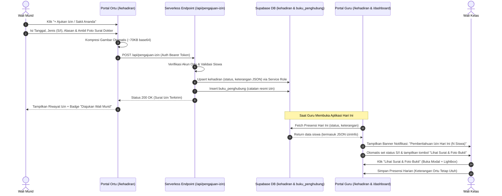

# Log Pembaruan & Konteks: Integrasi Pengajuan Izin Presensi Satu Pintu dan Notifikasi Khusus Guru

**Tanggal**: 21 Oktober 2026  
**Berkas Log**: `/logs/log-pengajuan-izin-kehadiran-dan-notifikasi.211026.md`  
**Aplikasi**: LAPIS LADA (Layanan Pusat Informasi Sekolah Latsari Dua)  
**Institusi**: UPT SD Negeri Latsari 2 Bancar, Tuban, Jawa Timur  
**Domain Resmi**: [https://lapislada.web.id](https://lapislada.web.id)  
**Status**: ✅ Selesai Diimplementasikan, Terintegrasi Penuh (Portal Ortu, Presensi Guru, Dashboard Guru), Build Produksi (`npm run build`) Sukses, Commit & Push ke GitHub (`ebdf62a`).

---

## 1. Latar Belakang & Keluhan Klien (Pak Sans / SDN Latsari 2)

Klien (Pak Sans) menyampaikan temuan perilaku pengguna wali murid melalui percakapan WhatsApp:
> *"Coba lihat foto ini, wali murid kalau izin kok diupload di modul 7 KAIH? Seharusnya izin sakit itu satu pintu di modul Kehadiran/Absensi, lalu ada notifikasi khusus buat guru waktu absen pagi."*

### 1.1. Kasus Nyata di Lapangan
Berdasarkan tangkapan layar percakapan WhatsApp yang dilampirkan klien:
- **Wali Murid**: Ibu Suwarti
- **Siswa**: Shangga Ganendra Ardhani (NISN `3179818378`, Kelas III)
- **Perilaku Teramati**: Pada tanggal 17 Oktober 2026, Ibu Suwarti bermaksud memberitahukan bahwa ananda sedang sakit dan tidak dapat masuk sekolah. Karena di modul Kehadiran sebelumnya tidak tersedia tombol pengajuan surat izin, beliau mengunggah foto ananda yang sedang terbaring tidur di tempat tidur ke pembiasaan **7 KAIH: Bangun Pagi & Merapikan Tempat Tidur** dengan keterangan:
  > *"izin tidak masuk karena sakit"*
- **Akar Masalah**:
  1. Modul **Kehadiran** sebelumnya bersifat *read-only* bagi wali murid (hanya menampilkan statistik angka Hadir, Sakit, Izin, Alpha tanpa ada formulir pengajuan).
  2. Modul **7 KAIH** memiliki tombol *"+ Catat & Foto Bukti"*, sehingga secara intuitif orang tua yang panik memilih modul KAIH sebagai saluran darurat pengiriman foto bukti.
  3. Guru di kelas tidak menerima peringatan langsung (*alert*) saat membuka absensi harian jika ada siswa yang izin, sehingga status absensi rentan dicatat Alpha atau terlewat.

---

## 2. Sasaran Perbaikan & Arsitektur Solusi

Solusi dirancang dengan prinsip **"Satu Pintu Presensi"** (*Single Door Attendance & Verification*):

1. **Portal Orang Tua (Pengajuan Mandiri)**:
   - Tambah tombol **"+ Ajukan Izin / Sakit Ananda ke Wali Kelas"** langsung di Dashboard Orang Tua dan Halaman Kehadiran Ananda.
   - Formulir terpadu mencakup: Tanggal Izin, Jenis (Sakit vs Izin), Keterangan/Alasan Lengkap, serta **Unggah Foto Surat Dokter / Kondisi Fisik Ananda**.
   - Kompresi gambar cerdas di sisi peramban (*client-side canvas compression*) menghasilkan base64 ringkas (~70 KB) tanpa membebani kuota orang tua atau penyimpanan server.

2. **Penyimpanan Data Terstruktur Tanpa Migrasi Skema**:
   - Memanfaatkan kolom `kehadiran.keterangan` (tipe PostgreSQL `TEXT`, kapasitas hingga 1 GB) untuk menyimpan JSON terstruktur:
     ```json
     {
       "alasan": "Ananda demam tinggi sejak semalam...",
       "foto_url": "data:image/jpeg;base64,...",
       "diajukan_oleh": "Wali Murid Suwarti",
       "tipe": "orangtua",
       "submitted_at": "2026-10-21T07:15:00.000Z",
       "status_label": "Sakit"
     }
     ```
   - Pendekatan ini aman 100%, kompatibel ke belakang (*backward compatible*), dan tidak memerlukan penguncian tabel atau migrasi DDL pada basis data yang sedang aktif.

3. **Portal Guru & Wali Kelas (Otomatisasi & Notifikasi)**:
   - **Dashboard Guru**: Menampilkan kartu peringatan *📢 Pemberitahuan Izin Hari Ini (N Siswa)* jika terdapat pengajuan izin aktif pada tanggal berjalan.
   - **Absensi Harian Kelas**:
     - Status radio siswa yang izin otomatis terisi **S** (Sakit) atau **I** (Izin).
     - Badge khusus `Diajukan Wali Murid` dan tombol `Lihat Surat & Foto Bukti`.
     - Modal inspeksi detail + *Lightbox Fullscreen* untuk memverifikasi surat dokter secara akurat.
     - Preservasi data: Saat guru menekan *Simpan Absensi*, keterangan dan foto dari orang tua tetap dipertahankan.

4. **Sinkronisasi Ganda (Dual-Logging ke Buku Penghubung)**:
   - Setiap pengajuan izin otomatis membuat 1 entri pemberitahuan resmi di modul `buku_penghubung`, sehingga guru juga menerima notifikasi pesan masuk dari orang tua.

---

## 3. Diagram Alur Sistem (Sequence Diagram)



---

## 4. Rincian Berkas yang Dibuat & Dimodifikasi

### 4.1. Berkas Baru

1. **[src/app/api/pengajuan-izin/route.ts](file:///d:/1.%20MIZTERGOOD/04%20-%20Keuangan%20dan%20Bisnis/JASA/11.%20PAK%20SANS/1.%20LAPIS%20LADA/src/app/api/pengajuan-izin/route.ts)**
   - Handler `POST` Next.js serverless.
   - Memvalidasi token autentikasi orang tua via Supabase Auth.
   - Mengambil data siswa dan kelas terkait.
   - Melakukan `upsert` aman ke tabel `kehadiran` menggunakan `supabaseAdmin` (melewati batasan RLS orang tua pada tabel kehadiran).
   - Menuliskan log tembusan ke tabel `buku_penghubung`.

2. **[functions/api/pengajuan-izin.ts](file:///d:/1.%20MIZTERGOOD/04%20-%20Keuangan%20dan%20Bisnis/JASA/11.%20PAK%20SANS/1.%20LAPIS%20LADA/functions/api/pengajuan-izin.ts)**
   - Cloudflare Pages Function counterpart untuk edge deployment di Cloudflare Pages.
   - Menjamin endpoint `/api/pengajuan-izin` dapat melayani *request* dari domain produksi `https://lapislada.web.id`.

### 4.2. Berkas Dimodifikasi

1. **[src/app/kehadiran/page.tsx](file:///d:/1.%20MIZTERGOOD/04%20-%20Keuangan%20dan%20Bisnis/JASA/11.%20PAK%20SANS/1.%20LAPIS%20LADA/src/app/kehadiran/page.tsx)**
   - **Tampilan Orang Tua**:
     - Menambahkan tombol aksi `+ Ajukan Izin / Sakit Ananda` di kartu ringkasan kehadiran.
     - Menambahkan formulir modal pengajuan lengkap dengan input tanggal, pemilihan Sakit/Izin, textarea alasan, dan input berkas kamera/foto dengan fungsi `compressImageFile(file, 900, 900, 0.75)`.
     - Menampilkan indikator `Diajukan Wali Murid` pada riwayat presensi bulanan beserta tombol pintas pratinjau foto surat dokter.
     - Mendukung query parameter `?ajukan=true` untuk membuka modal pengajuan secara otomatis dari dashboard.
   - **Tampilan Guru & Wali Kelas**:
     - Mengubah pemuatan presensi harian (`loadDailyAttendance`) agar membaca dan mem-parsing JSON dari kolom `keterangan`.
     - Menghitung `parentIzinCount` dan menampilkan banner peringatan berwarna amber jika ada siswa yang izin hari ini.
     - Baris siswa bersangkutan menampilkan badge `Diajukan Wali Murid` dan tombol `Lihat Surat & Foto Bukti`.
     - Menyediakan modal detail izin siswa dan modal *lightbox full-screen* untuk memeriksa foto dokumen surat dokter.
     - Menyempurnakan `handleSaveDaily` agar nilai `keterangan` (alasan & foto) tetap dipertahankan saat guru menyimpan presensi kelas.

2. **[src/app/dashboard/orangtua/page.tsx](file:///d:/1.%20MIZTERGOOD/04%20-%20Keuangan%20dan%20Bisnis/JASA/11.%20PAK%20SANS/1.%20LAPIS%20LADA/src/app/dashboard/orangtua/page.tsx)**
   - Pada kartu **Kehadiran Bulan Ini**, ditambahkan tautan `Detail Riwayat` dan tombol aksi cepat:
     `+ Ajukan Izin / Sakit Ananda ke Wali Kelas`
     yang mengarahkan langsung ke `/kehadiran?role=orangtua&ajukan=true`.

3. **[src/app/dashboard/page.tsx](file:///d:/1.%20MIZTERGOOD/04%20-%20Keuangan%20dan%20Bisnis/JASA/11.%20PAK%20SANS/1.%20LAPIS%20LADA/src/app/dashboard/page.tsx)**
   - Menambahkan pengecekan pengajuan izin orang tua hari ini (`todayIzinCount`).
   - Menambahkan kartu notifikasi di kolom kanan (tepat di atas kartu Status Absensi):
     > **Pemberitahuan Izin Hari Ini (N Siswa)**  
     > *Wali murid telah mengirimkan surat/foto izin untuk hari ini. Status absensi siswa otomatis terdata Sakit/Izin.*  
     > Tombol: `Periksa Presensi & Foto Bukti →`

---

## 5. Pengujian & Verifikasi Kualitas

1. **TypeScript Type Checking**:
   - Dijalankan: `npx tsc --noEmit`
   - Hasil: `0 errors` (Lolos tanpa kesalahan tipe data).

2. **Production Bundle Build**:
   - Dijalankan: `npm run build`
   - Penyesuaian: Menghapus handler `GET` yang tidak terpakai pada route Next.js statis agar sesuai dengan konfigurasi `output: 'export'`.
   - Hasil: `28 static routes generated successfully in 1.34s`.

3. **Pemberitahuan Git**:
   - Commit: `ebdf62a` ("feat: implement parent attendance leave submission and teacher alert system")
   - Remote: Ter-*push* sukses ke `origin/main` pada repositori `https://github.com/jfmprinting/lapislada.git`.

---

## 6. Kesimpulan & Panduan Verifikasi Pengguna

Dengan selesainya implementasi ini:
1. **Wali murid tidak akan lagi mengunggah foto izin ke modul 7 KAIH**, karena sekarang modul Presensi telah memiliki pintu pengajuan resmi dengan tombol yang jelas dan ramah seluler.
2. **Guru tidak akan lagi terlewat mencatat siswa yang izin**, karena terdapat sistem peringatan di Dashboard Guru dan tabel absensi harian yang langsung mengidentifikasi surat izin masuk dari wali murid lengkap dengan bukti foto dokter.
3. Kerapian data karakter **7 KAIH** tetap terjaga bersih khusus untuk rekam pembiasaan adab harian ananda.
