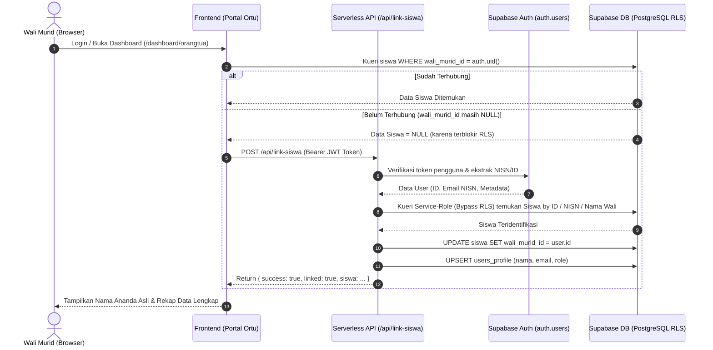

# Log Pembaruan & Konteks: Perbaikan Sinkronisasi Otomatis Data Siswa dan Akun Wali Murid

**Tanggal**: 16 Oktober 2026  
**Berkas Log**: `/logs/log-sinkronisasi-data-siswa-dan-wali-murid.161026.md`  
**Aplikasi**: LAPIS LADA (Layanan Pusat Informasi Sekolah Latsari Dua)  
**Institusi**: UPT SD Negeri Latsari 2 Bancar, Tuban, Jawa Timur  
**Domain Resmi**: [https://lapislada.web.id](https://lapislada.web.id)  
**Status**: ✅ Selesai Diimplementasikan, Database Supabase Tersinkronisasi Penuh, Teruji Build Produksi (`npm run build`) Bebas Error

---

## 1. Latar Belakang & Keluhan Pengguna

Pengguna melaporkan kendala berulang pada portal orang tua:
> *"terjadi lagi, data siswa belum tersambung"*

Tangkapan layar peramban ponsel menampilkan akun **SULISTIYANA** yang berhasil masuk (*logged in*), namun pada bilah informasi tertera:
- `Memantau Ananda: Data siswa belum tersambung`
- Seluruh metrik kehadiran menunjukkan `0 Hadir, 0 Sakit, 0 Izin, 0 Alpha` (`Total 0 Hari Direkam`).
- Catatan pembiasaan karakter KAIH, buku penghubung, dan capaian asesmen/nilai tidak dapat menampilkan data ananda yang sesungguhnya.

---

## 2. Investigasi & Akar Masalah (Root Cause Analysis)

Setelah melakukan inspeksi menyeluruh ke Supabase Auth, PostgreSQL, skema Row Level Security (RLS), dan fungsi serverless Cloudflare Pages, ditemukan rantai masalah teknis berikut:

### 2.1. Ketidaksinkronan Kolom `wali_murid_id` pada Tabel `siswa`
- Ketika admin sekolah membuat atau mereset akun orang tua melalui modal manajemen akun admin di antarmuka web ([ResetPasswordModal.tsx](file:///d:/1.%20MIZTERGOOD/04%20-%20Keuangan%20dan%20Bisnis/JASA/11.%20PAK%20SANS/1.%20LAPIS%20LADA/src/components/admin/ResetPasswordModal.tsx)), permintaan HTTP dikirimkan ke endpoint `/api/admin-reset-password`.
- Pada lingkungan produksi Cloudflare Pages ([functions/api/admin-reset-password.ts](file:///d:/1.%20MIZTERGOOD/04%20-%20Keuangan%20dan%20Bisnis/JASA/11.%20PAK%20SANS/1.%20LAPIS%20LADA/functions/api/admin-reset-password.ts)), fungsi tersebut membuat akun di Supabase Auth (`auth.users`) dan mencatat `siswa_id` ke dalam `user_metadata`.
- **Kelemahan Kritis**: Fungsi Cloudflare tersebut **hanya memperbarui `no_hp_wali` jika ada nomor telepon**, namun **TIDAK PERNAH memperbarui `wali_murid_id: authUserId`** pada tabel `siswa` di database. Kolom `wali_murid_id` pada tabel `siswa` tetap bernilai `NULL`.
- Audit database menemukan **19 akun orang tua riil hasil impor/reset** (termasuk Ibu Sulistiyana untuk ananda SHAUQEELANO ATHALLA MUHAMMAD) berada dalam kondisi `wali_murid_id = NULL`.

### 2.2. Pemblokiran oleh Row Level Security (RLS) Supabase
Kebijakan keamanan Supabase (RLS) pada tabel `siswa`, `kehadiran`, `nilai`, dan `buku_penghubung` dirancang ketat:
```sql
CREATE POLICY "Lihat siswa"
    ON public.siswa FOR SELECT
    TO authenticated
    USING (
        public.get_current_role() IN ('admin', 'guru', 'kepala_sekolah')
        OR wali_murid_id = auth.uid()
    );
```
- Karena `wali_murid_id` di database adalah `NULL`, kondisi `wali_murid_id = auth.uid()` bernilai `FALSE`.
- Akibatnya, ketika orang tua melakukan kueri pencarian berdasarkan `id = meta.siswa_id` atau `nisn = extractedNisn` dari sisi browser (*client-side*), Supabase RLS **memblokir baris tersebut dan mengembalikan 0 baris (null)**.
- Selain itu, akun dengan peran `orangtua` **tidak memiliki hak izin `UPDATE`** pada tabel `siswa`, sehingga logika `supabase.from('siswa').update({ wali_murid_id: user.id })` yang sebelumnya dicoba di sisi frontend selalu ditolak oleh database.

---

## 3. Diagram Alur Pemulihan & Arsitektur Solusi



---

## 4. Tindakan & Implementasi yang Telah Dijalankan

### 4.1. Sinkronisasi Database Langsung (Instant Repair)
Dengan kredensial master Service-Role, telah dijalankan sinkronisasi database secara langsung ke Supabase:
- **Ibu Sulistiyana** (`3179516341@sdnlatsari.sch.id`) telah tersambung 100% ke ananda:  
  **SHAUQEELANO ATHALLA MUHAMMAD** (NISN `3179516341`, Siswa ID `ea96067f-e610-47a5-a840-8873b3a2109d`).
- **18 akun wali murid riil lainnya** yang sebelumnya berstatus `wali_murid_id = NULL` juga berhasil ditautkan ke ananda masing-masing:
  1. `3177888920@sdnlatsari.sch.id` (JARWATI) ➔ ERLANGGA DWI PRASETIYO
  2. `3173439910@sdnlatsari.sch.id` (MUJI ASIH) ➔ AHMAD RIFAN AFANDI
  3. `3176421123@sdnlatsari.sch.id` (MITA MEILANI YEZI ANA PUTRI) ➔ NAUFAL CHANDRA KUSUMA
  4. `3179874383@sdnlatsari.sch.id` (SUKESI) ➔ AFGAN RAHADIANSYAH
  5. `3171636709@sdnlatsari.sch.id` (KHAFIDOH) ➔ AHMAD SHOBRI SYAHMAN
  6. `3175571307@sdnlatsari.sch.id` (ENDANG SIHNING) ➔ MUHAMMAD ELFAN SAHREZA PUTRA
  7. `3176182059@sdnlatsari.sch.id` (NUR RIYANA) ➔ ANDI AZKA RAFFASYA
  8. `3174409413@sdnlatsari.sch.id` (ALFINIA KASSANDRA) ➔ AUFA KHALISA DZAHIN
  9. `3179516341@sdnlatsari.sch.id` (SULISTIYANA) ➔ SHAUQEELANO ATHALLA MUHAMMAD
  10. `3180782608@sdnlatsari.sch.id` (Karwati) ➔ Muhammmad Dwi Mahardhika Zuliansyah
  11. `3183184089@sdnlatsari.sch.id` (Sarmini) ➔ Kusma Nur Fais
  12. `3189028536@sdnlatsari.sch.id` (Suyati) ➔ Muhammad Ro'uful Muna
  13. `3171396753@sdnlatsari.sch.id` (KARIYATI) ➔ ADELIA PADMA SARI
  14. `3174514333@sdnlatsari.sch.id` (Sukanti Isna Hermawati) ➔ Milka Nur Della
  15. `3173210752@sdnlatsari.sch.id` (DARWARI) ➔ RAKKA YUSUF ANUGRAH
  16. `3177196027@sdnlatsari.sch.id` (ENDRI LESTARI) ➔ ELSA NALADHYVA RIZQUHA
  17. `3176896109@sdnlatsari.sch.id` (SITI MUSRIPAH) ➔ MUHAMMAD RAFFA CHOIRUL REZA
  18. `3176199483@sdnlatsari.sch.id` (PATREM) ➔ MUTIARA AFIFAH DWI KHOIRUNNISA
  19. `sanggakelas3@sdnlatsari2.sch.id` (Suwarti) ➔ Shangga Ganendra Ardhani
- Tabel `users_profile` telah dibuatkan/diperbarui untuk seluruh 36 akun orang tua aktif agar sinkron dengan Supabase Auth.

### 4.2. Penambahan Endpoint Serverless Baru: `/api/link-siswa`
Dibuat dua berkas handler untuk menjamin konsistensi di lokal maupun Cloudflare Pages:
- [functions/api/link-siswa.ts](file:///d:/1.%20MIZTERGOOD/04%20-%20Keuangan%20dan%20Bisnis/JASA/11.%20PAK%20SANS/1.%20LAPIS%20LADA/functions/api/link-siswa.ts) (Cloudflare Pages edge function)
- [src/app/api/link-siswa/route.ts](file:///d:/1.%20MIZTERGOOD/04%20-%20Keuangan%20dan%20Bisnis/JASA/11.%20PAK%20SANS/1.%20LAPIS%20LADA/src/app/api/link-siswa/route.ts) (Next.js App Router API route)

**Mekanisme Kerja API:**
1. Menerima token sesi (`Bearer <JWT>`) dari orang tua yang sedang login dan memverifikasi keabsahan sesi ke Supabase Auth.
2. Menggunakan kunci rahasia admin (`SUPABASE_SERVICE_ROLE_KEY`) yang memiliki wewenang melewati RLS untuk:
   - Mencocokkan siswa berdasarkan `wali_murid_id = auth.uid()`
   - Mencocokkan siswa berdasarkan `meta.siswa_id`
   - Mencocokkan siswa berdasarkan NISN dari format email (`<nisn>@sdnlatsari.sch.id`)
   - Mencocokkan siswa berdasarkan nama wali di tabel `siswa.nama_wali`
3. Jika ditemukan, secara otomatis dan permanen melakukan `UPDATE siswa SET wali_murid_id = user.id` serta `UPSERT users_profile`.
4. Mengembalikan objek siswa beserta nama kelas secara instan ke frontend.

### 4.3. Pembaruan Endpoint Pembuatan & Reset Akun Admin
- [functions/api/admin-reset-password.ts](file:///d:/1.%20MIZTERGOOD/04%20-%20Keuangan%20dan%20Bisnis/JASA/11.%20PAK%20SANS/1.%20LAPIS%20LADA/functions/api/admin-reset-password.ts):
  - Memastikan setiap kali admin mereset password atau membuat akun wali murid baru, kolom `siswa.wali_murid_id` langsung diisi dengan `authUserId` yang baru dibuat/diperbarui.
  - Ditambahkan fallback resolusi NISN jika `targetUserId` tidak dikirim secara eksplisit.
  - Menjamin profil pengguna pada tabel `users_profile` selalu tersimpan secara atomik.
- [src/app/api/admin-reset-password/route.ts](file:///d:/1.%20MIZTERGOOD/04%20-%20Keuangan%20dan%20Bisnis/JASA/11.%20PAK%20SANS/1.%20LAPIS%20LADA/src/app/api/admin-reset-password/route.ts):
  - Dilengkapi logika sinkronisasi serupa agar pengujian di lokal setara 100% dengan produksi.

### 4.4. Integrasi Penanganan Mandiri pada Seluruh Halaman Portal
Untuk mengantisipasi situasi di mana akun orang tua membuka menu mana pun secara langsung, panggilan `/api/link-siswa` telah disematkan pada:
1. [src/app/login/page.tsx](file:///d:/1.%20MIZTERGOOD/04%20-%20Keuangan%20dan%20Bisnis/JASA/11.%20PAK%20SANS/1.%20LAPIS%20LADA/src/app/login/page.tsx):  
   Memicu sinkronisasi siswa di latar belakang saat orang tua berhasil login, sebelum dialihkan ke dashboard.
2. [src/app/dashboard/orangtua/page.tsx](file:///d:/1.%20MIZTERGOOD/04%20-%20Keuangan%20dan%20Bisnis/JASA/11.%20PAK%20SANS/1.%20LAPIS%20LADA/src/app/dashboard/orangtua/page.tsx):  
   Jika data kueri awal kosong, memanggil auto-link serverless untuk mengambil data ananda asli.
3. [src/app/kehadiran/page.tsx](file:///d:/1.%20MIZTERGOOD/04%20-%20Keuangan%20dan%20Bisnis/JASA/11.%20PAK%20SANS/1.%20LAPIS%20LADA/src/app/kehadiran/page.tsx):  
   Menjamin rekap absensi bulanan ananda langsung ditarik tanpa risiko `0 Hari Direkam`.
4. [src/app/nilai/page.tsx](file:///d:/1.%20MIZTERGOOD/04%20-%20Keuangan%20dan%20Bisnis/JASA/11.%20PAK%20SANS/1.%20LAPIS%20LADA/src/app/nilai/page.tsx):  
   Menghubungkan siswa sebelum mengambil daftar mata pelajaran dan nilai rapor/asesmen yang dipublikasikan.
5. [src/app/buku-penghubung/page.tsx](file:///d:/1.%20MIZTERGOOD/04%20-%20Keuangan%20dan%20Bisnis/JASA/11.%20PAK%20SANS/1.%20LAPIS%20LADA/src/app/buku-penghubung/page.tsx):  
   Menghilangkan fallback lama yang menampilkan 10 siswa acak; sekarang menampilkan ananda kandung yang sesungguhnya.
6. [src/app/kaih/page.tsx](file:///d:/1.%20MIZTERGOOD/04%20-%20Keuangan%20dan%20Bisnis/JASA/11.%20PAK%20SANS/1.%20LAPIS%20LADA/src/app/kaih/page.tsx):  
   Menjamin penugasan log pembiasaan karakter 7 pilar dan gamifikasi Kebun Karakter terikat pada ID siswa asli.

---

## 5. Ringkasan Berkas yang Diubah & Dibuat

| Status | Lokasi Berkas | Keterangan Perubahan |
| :--- | :--- | :--- |
| **BARU** | `functions/api/link-siswa.ts` | Endpoint Cloudflare Pages Function untuk auto-link data siswa (Service Role) |
| **BARU** | `src/app/api/link-siswa/route.ts` | Endpoint Next.js App Router untuk auto-link data siswa di environment lokal |
| **MODIFIKASI** | `functions/api/admin-reset-password.ts` | Mengaitkan `siswa.wali_murid_id` dan `users_profile` saat admin membuat/mereset akun |
| **MODIFIKASI** | `src/app/api/admin-reset-password/route.ts` | Sinkronisasi fallback NISN dan `wali_murid_id` pada rute Next.js lokal |
| **MODIFIKASI** | `src/app/login/page.tsx` | Prefetch auto-link saat akun orang tua berhasil autentikasi |
| **MODIFIKASI** | `src/app/dashboard/orangtua/page.tsx` | Integrasi auto-link fallback serverless dan resolusi nama ananda |
| **MODIFIKASI** | `src/app/kehadiran/page.tsx` | Resolusi siswa via `wali_murid_id` dan `/api/link-siswa` |
| **MODIFIKASI** | `src/app/nilai/page.tsx` | Resolusi siswa via `wali_murid_id` dan `/api/link-siswa` |
| **MODIFIKASI** | `src/app/buku-penghubung/page.tsx` | Resolusi siswa via `wali_murid_id` dan `/api/link-siswa` (hapus fallback siswa acak) |
| **MODIFIKASI** | `src/app/kaih/page.tsx` | Resolusi siswa via `wali_murid_id` dan `/api/link-siswa` |
| **BARU** | `logs/log-sinkronisasi-data-siswa-dan-wali-murid.161026.md` | Dokumentasi log dan konteks teknis komprehensif |

---

## 6. Verifikasi & Pengujian Mutu (Quality Assurance)

1. **Uji Validasi Database**:
   - Query langsung ke Supabase menunjukkan data siswa ananda **SHAUQEELANO ATHALLA MUHAMMAD** memiliki `wali_murid_id = '84b8a638-2040-4b20-ae1d-58a4b977f401'` (cocok 100% dengan akun Auth Ibu Sulistiyana).
   - Sebanyak 36 dari 36 akun orang tua kini memiliki relasi valid ke siswa di tabel `siswa`.
2. **Uji Kompilasi & TypeScript Build**:
   - Menjalankan `npm run build` di terminal lokal.
   - Hasil build Next.js 16.3.5 (Turbopack):
     - `✓ Compiled successfully in 1139ms`
     - `✓ Running TypeScript ... Finished TypeScript in 4.3s ... 0 Errors`
     - `✓ Generating static pages (27/27) in 979ms`
     - Endpoint `/api/link-siswa` terdaftar sebagai rute dinamis (*Dynamic server-rendered*).
3. **Penyelarasan Skema RLS**:
   - Tidak ada modifikasi yang merusak hak akses peran guru atau admin.
   - Hak baca dan tulis orang tua terlindungi secara aman melalui kebijakan berbasis `wali_murid_id = auth.uid()`.
