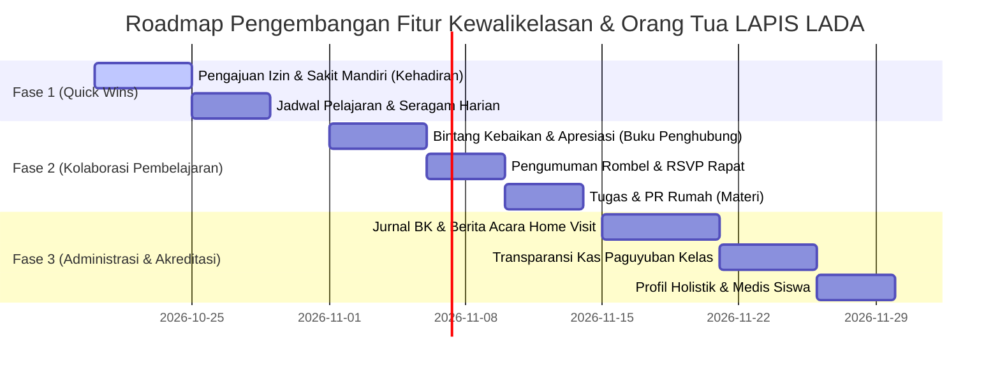

# Cetak Biru & Rencana Strategis: Upgrade Fitur Kewalikelasan & Portal Orang Tua

**Tanggal Dokumen**: 16 Oktober 2026  
**Berkas Log**: `/logs/rencana-upgrade-kewalikelasan-dan-orangtua.161026.md`  
**Aplikasi**: LAPIS LADA (*Layanan Pusat Informasi Sekolah Latsari Dua*)  
**Institusi**: UPT SD Negeri Latsari 2 Bancar, Tuban, Jawa Timur  
**Domain Resmi**: [https://lapislada.web.id](https://lapislada.web.id)  
**Status**: 📋 Rencana Strategis Tersimpan (Siap Dikaji & Diprioritaskan untuk Implementasi)

---

## 1. Latar Belakang & Filosofi Pengembangan

Dalam ekosistem pendidikan dasar, khususnya di lingkungan **UPT SD Negeri Latsari 2 Bancar**, relasi antara **Wali Kelas** dan **Orang Tua / Wali Murid** merupakan kunci utama keberhasilan belajar, kedisiplinan, dan pembentukan karakter peserta didik.

Selama ini, sistem **LAPIS LADA** telah berhasil meletakkan pondasi kuat melalui:
1. *Buku Penghubung Digital 2 Arah* (catatan kasuistik & tindak lanjut).
2. *Pencatatan Presensi & Rekap Kehadiran Bulanan* (standar format dinas).
3. *Pengelolaan Nilai & Leger Kelas* (Formatif, Sumatif, dan Kurikulum Merdeka).
4. *Gamifikasi 7 KAIH* (*Karakter Anak Indonesia Hebat* dengan Kebun & Hutan Kelas).
5. *Transparansi Dana BOS & Pengumuman Sekolah*.

Namun demikian, masih terdapat celah komunikasi operasional harian yang umumnya masih tercecer di grup WhatsApp paguyuban atau chat pribadi guru. Dokumen ini merumuskan rencana pembaruan (*upgrade plan*) yang komprehensif, terstruktur, dan siap dieksekusi secara bertahap.

---

## 2. Analisis Kebutuhan Lapangan & Pain Points

```
+------------------------------------+       +------------------------------------+
|       WALI KELAS (GURU)            |       |       ORANG TUA (WALI MURID)       |
+------------------------------------+       +------------------------------------+
| 1. Chat izin sakit sering tenggelam|       | 1. Lupa/bingung jadwal seragam     |
| 2. Input absensi manual berulang   | <---> | 2. Bingung ananda ada PR atau tidak|
| 3. Administrasi PKG/BK belum rapi  |       | 3. Was-was saat buka buku catatan  |
| 4. Pertanyaan seragam berulang     |       | 4. Ingin transparansi uang kas     |
+------------------------------------+       +------------------------------------+
```

1. **Kendala Nyata Wali Kelas**:
   - Menerima surat/izin sakit via chat WhatsApp pribadi pada pagi hari saat jam sibuk masuk kelas, berisiko lupa tercatat di rekap absensi resmi.
   - Sering menjawab pertanyaan berulang di grup paguyuban: *"Bu guru, besok seragamnya apa ya?"* atau *"Besok pelajaran apa saja yang dibawa?"*.
   - Membutuhkan portofolio resmi bimbingan konseling dan bukti kunjungan rumah (*home visit*) untuk penilaian kinerja guru (PKG) dan akreditasi sekolah.
   - Buku penghubung saat ini terkesan formal untuk kasus/masalah, belum ada wadah cepat untuk memberikan apresiasi positif harian.

2. **Kebutuhan Nyata Orang Tua**:
   - Memerlukan akses cepat satu pintu untuk mengetahui jadwal harian, perlengkapan yang wajib dibawa, dan seragam sekolah tanpa harus menggulir riwayat chat grup WA.
   - Membutuhkan kemudahan mengajukan izin/sakit ananda cukup dari ponsel, tanpa harus mengetik surat manual di kertas saat situasi darurat.
   - Menginginkan transparansi kas kelas yang dikumpulkan secara sukarela oleh paguyuban kelas.
   - Menginginkan laporan ringkas capaian pembelajaran tengah semester yang mudah dipahami (bukan tabel angka rumit).

---

## 3. Peta Pembaruan Menu yang Sudah Ada (Existing Enhancements)

### 3.1. Modul Kehadiran (`/kehadiran`)
* **A. Fitur Pengajuan Izin/Sakit Mandiri oleh Orang Tua**:
  * Orang tua dapat mengklik tombol **"Ajukan Izin / Sakit"** langsung dari beranda portal ortu.
  * Formulir sederhana: Pilihan Tanggal, Kategori (Sakit / Izin Acara Keluarga / Lainnya), Keterangan Singkat, dan Unggah Foto Surat Dokter atau Surat Tertulis.
  * **Di sisi Wali Kelas**: Tampil lencana (*badge*) *"Pengajuan Izin Menunggu Verifikasi"*. Wali kelas cukup menekan tombol `[Setujui]` atau `[Tolak]`. Jika disetujui, sistem otomatis mencatat status **S** atau **I** pada rekap presensi hari tersebut.
* **B. Sistem Peringatan Dini Ketidakhadiran (*Early Warning System*)**:
  * Peringatan otomatis muncul di dashboard wali kelas jika siswa absen $\ge 3$ hari berturut-turut tanpa keterangan yang jelas.
  * Tombol aksi instan: *"Kirim Sapaan Perhatian via WhatsApp"* atau *"Jadwalkan Kunjungan Rumah (Home Visit)"*.

---

### 3.2. Modul Buku Penghubung (`/buku-penghubung`)
* **A. Kotak Bintang Kebaikan & Apresiasi Harian (*Praise & Positive Notes*)**:
  * Penambahan tab/kategori **"Apresiasi / Bintang Kebaikan"** di samping kategori kasuistik (Masalah & Saran).
  * Guru dapat mengapresiasi hal-hal positif: kejujuran, peningkatan fokus belajar, suka menolong teman, atau kerapian tugas.
  * Memberi dampak psikologis positif: orang tua tidak lagi merasa cemas saat melihat notifikasi buku penghubung karena isinya bisa berupa kabar gembira.
* **B. Penjadwalan Sesi Konsultasi Tatap Muka (*Parent-Teacher Booking*)**:
  * Fitur permohonan temu wali kelas dengan pilihan slot waktu yang ditentukan guru (misal: Jumat pukul 10.30 - 11.30 WIB atau Sabtu pagi).
  * Mencegah orang tua datang mendadak di tengah jam mengajar aktif.

---

### 3.3. Modul Nilai Siswa (`/nilai`)
* **A. Kartu Progres Belajar Tengah Semester (*Digital Progress Snapshot*)**:
  * Selain Leger Nilai lengkap untuk arsip sekolah, sediakan fitur cetak/ekspor ringkasan 1 halaman per siswa yang menampilkan:
    * Capaian Tujuan Pembelajaran (TP) yang sudah tuntas dengan sangat baik.
    * Materi yang masih memerlukan pendampingan belajar di rumah.
    * Saran belajar konkret dari wali kelas untuk orang tua.
* **B. Penandaan Siswa Remedial & Panduan Belajar Mandiri**:
  * Siswa di bawah Kriteria Ketercapaian Tujuan Pembelajaran (KKTP) otomatis diberi tanda khusus, dilengkapi rekomendasi materi di modul `/materi` yang relevan untuk dipelajari kembali bersama orang tua.

---

### 3.4. Modul Materi Pelajaran (`/materi`)
* **A. Checklist Buku Kerja & PR Rumah (*Homework & Task Tracker*)**:
  * Di samping modul bahan ajar (Google Drive), tambahkan sub-fitur **"Tugas Rumah / PR Berjalan"**.
  * Informasi mencakup: Mata Pelajaran, Batas Waktu Pengumpulan (*Deadline*), dan Petunjuk Pengerjaan.
  * Orang tua dapat menandai tombol `[✓ Sudah Selesai Dikerjakan]` di rumah sebagai kontrol belajar anak.

---

### 3.5. Modul Pengumuman Sekolah (`/pengumuman`)
* **A. Segmentasi Pengumuman Tingkat Kelas/Rombel**:
  * Tambahkan filter target penerima: *Semua Kelas (Umum)* atau *Khusus Kelas Tertentu (Rombel)*.
  * Wali kelas dapat menerbitkan pengumuman internal (misal: iuran sukarela lomba kelas, perlengkapan praktik SBdP hari esok, atau foto bersama kelas).
* **B. Formulir RSVP Kehadiran Undangan Paguyuban**:
  * Jajak pendapat instan: `[✓ Akan Hadir]` / `[Izin / Diwakilkan]` untuk rapat komite/paguyuban kelas, sehingga wali kelas memiliki kepastian jumlah konsumsi dan kursi pertemuan.

---

## 4. Perancangan Modul / Menu Baru (New High-Value Menus)

```
                 USULAN MENU BARU LAPIS LADA
                              │
  ┌───────────────────────────┼───────────────────────────┐
  │                           │                           │
  ▼                           ▼                           ▼
1. Jadwal & Seragam     2. Jurnal BK & Home Visit   3. Kas Paguyuban Kelas
  - Seragam harian        - Catatan konseling         - Pemasukan & belanja
  - Mapel Senin-Sabtu     - Berita acara kunjungan    - Saldo transparan
  - Perlengkapan wajib    - Bukti kinerja PKG         - Pengurus paguyuban
```

---

### 4.1. Menu Baru 1: "Jadwal Pelajaran & Seragam Harian" (`/jadwal-kelas`)
* **Tujuan**: Mengakhiri kebingungan harian orang tua mengenai seragam dan buku pelajaran yang harus disiapkan anak.
* **Fitur Utama**:
  * **Tampilan Kartu Harian (Senin s/d Sabtu)**:
    * **Seragam Hari Ini**: Visual baju (Merah Putih, Batik Khas Sekolah, Pramuka Lengkap, atau Kaos Olahraga) beserta atribut khusus (topi, dasi, kaos kaki hitam/putih).
    * **Jadwal Pelajaran**: Daftar mata pelajaran terurut per jam pelajaran.
    * **Catatan Khusus**: Contoh *"Jumat Bersih membawa alat kebersihan mini"* atau *"Rabu memakai sepatu kets untuk PJOK"*.
  * **Auto-Highlight**: Pada tampilan ponsel orang tua, kartu hari ini dan esok hari otomatis berada di posisi teratas.

---

### 4.2. Menu Baru 2: "Jurnal Bimbingan & Kunjungan Rumah (Home Visit)" (`/jurnal-wali-kelas`)
* **Tujuan**: Melengkapi administrasi resmi wali kelas untuk keperluan supervisi Kepala Sekolah, Penilaian Kinerja Guru (PKG), dan akreditasi sekolah.
* **Fitur Utama**:
  * **Buku Bimbingan & Konseling Siswa**: Catatan berkala observasi perkembangan sosial, emosional, dan penanganan kendala belajar.
  * **Formulir & Berita Acara Home Visit**:
    * Identitas siswa & tanggal kunjungan.
    * Anggota keluarga yang ditemui.
    * Masalah yang diidentifikasi & solusi kesepakatan bersama.
    * Lampiran foto dokumentasi kunjungan.
    * Format cetak resmi berstandar dinas dengan kop surat UPT SD Negeri Latsari 2 Bancar dan tanda tangan Kepala Sekolah.

---

### 4.3. Menu Baru 3: "Paguyuban & Transparansi Kas Kelas" (`/paguyuban-kelas`)
* **Tujuan**: Mencegah kesalahpahaman terkait pengelolaan kas sukarela paguyuban orang tua murid.
* **Fitur Utama**:
  * **Bagan Pengurus Paguyuban**: Foto, nama, dan kontak Ketua Paguyuban Kelas, Bendahara, dan Sekretaris.
  * **Buku Kas Terbuka**:
    * Pemasukan (iuran sukarela, infak Jumat).
    * Pengeluaran (pembelian galon kelas, gorden, konsumsi lomba, santunan siswa sakit).
    * Saldo kas berjalan yang selalu terbarui.
    * Galeri nota/kuitansi belanja.
  * Hak akses: Wali kelas & Bendahara paguyuban memiliki hak *input*, seluruh orang tua rombel memiliki hak *view/audit*.

---

### 4.4. Menu Baru 4: "Buku Induk & Profil Holistik Siswa" (`/profil-siswa`)
* **Tujuan**: Menyediakan rekam medis dan diagnostik non-kognitif yang mudah diakses wali kelas saat keadaan darurat.
* **Fitur Utama**:
  * **Data Medis & Kebutuhan Khusus**: Riwayat alergi (makanan/obat), asma, riwayat kejang/alergi dingin, golongan darah, penggunaan kacamata.
  * **Kontak Darurat Alternatif**: Nomor telepon darurat keluarga selain orang tua inti (paman, bibi, kakek) jika orang tua tidak bisa dihubungi saat anak sakit di sekolah.
  * **Minat & Gaya Belajar**: Hobi, cita-cita, ekstrakurikuler yang diminati, dan gaya belajar dominan (Visual/Auditori/Kinestetik).

---

### 4.5. Menu Baru 5: "Pantauan Pembiasaan Rumah" (Ekstensi Modul 7 KAIH)
* **Tujuan**: Memperkuat pembiasaan karakter di rumah yang langsung bersinergi dengan gamifikasi Kebun & Hutan Karakter LAPIS LADA.
* **Fitur Utama**:
  * **Checklist Cepat Sebelum Tidur**:
    1. Beribadah / Sholat tepat waktu.
    2. Membaca buku cerita / literasi 15 menit.
    3. Merapikan tas & perlengkapan sekolah untuk esok hari.
    4. Istirahat / tidur malam sebelum pukul 21.00.
  * Setiap centang dari orang tua langsung menyumbang XP untuk menyiram tanaman karakter ananda di modul `/kaih`.

---

## 5. Rencana Tahapan Eksekusi (Roadmap Prioritas)



### Rekapitulasi Matriks Prioritas:

| Fase | Nama Fitur | Urgensi | Sasaran Pengguna | Estimasi Beban Kerja |
| :--- | :--- | :--- | :--- | :--- |
| **Fase 1** | **Pengajuan Izin/Sakit Mandiri** (`/kehadiran`) | 🟢 **Sangat Tinggi** | Orang Tua & Wali Kelas | 2-3 Hari |
| **Fase 1** | **Jadwal Pelajaran & Seragam Harian** (`/jadwal-kelas`) | 🟢 **Sangat Tinggi** | Orang Tua & Siswa | 2 Hari |
| **Fase 2** | **Apresiasi & Bintang Kebaikan** (`/buku-penghubung`) | 🟡 **Tinggi** | Wali Kelas & Orang Tua | 2-3 Hari |
| **Fase 2** | **Pengumuman Rombel & RSVP** (`/pengumuman`) | 🟡 **Tinggi** | Wali Kelas & Paguyuban | 2 Hari |
| **Fase 2** | **Checklist PR & Tugas Rumah** (`/materi`) | 🟡 **Sedang** | Guru Mapel, Siswa, Ortu | 2 Hari |
| **Fase 3** | **Jurnal BK & Home Visit** (`/jurnal-wali-kelas`) | 🔵 **Menengah (PKG)** | Wali Kelas & Kepsek | 3-4 Hari |
| **Fase 3** | **Papan Kas Paguyuban Kelas** (`/paguyuban-kelas`) | 🔵 **Menengah (Sosial)**| Pengurus Paguyuban & Ortu| 2-3 Hari |
| **Fase 3** | **Profil Holistik & Rekam Medis** (`/profil-siswa`) | 🔵 **Menengah** | Wali Kelas & Ortu | 2 Hari |

---

## 6. Contoh Rancangan Skema Database Supabase (Siap Diimplementasikan)

Berikut draf skema SQL jika salah satu fitur di atas hendak dieksekusi:

```sql
-- 1. Tabel Pengajuan Izin/Sakit dari Orang Tua
CREATE TABLE IF NOT EXISTS public.pengajuan_izin (
    id UUID PRIMARY KEY DEFAULT gen_random_uuid(),
    siswa_id UUID NOT NULL REFERENCES public.siswa(id) ON DELETE CASCADE,
    wali_murid_id UUID NOT NULL REFERENCES auth.users(id),
    tanggal_mulai DATE NOT NULL,
    tanggal_selesai DATE NOT NULL,
    kategori TEXT NOT NULL CHECK (kategori IN ('sakit', 'izin', 'lainnya')),
    keterangan TEXT NOT NULL,
    bukti_foto_url TEXT,
    status TEXT NOT NULL DEFAULT 'menunggu' CHECK (status IN ('menunggu', 'disetujui', 'ditolak')),
    diverifikasi_oleh UUID REFERENCES auth.users(id),
    catatan_guru TEXT,
    created_at TIMESTAMPTZ DEFAULT NOW(),
    updated_at TIMESTAMPTZ DEFAULT NOW()
);

-- 2. Tabel Jadwal Pelajaran & Seragam Harian Rombel
CREATE TABLE IF NOT EXISTS public.jadwal_kelas (
    id UUID PRIMARY KEY DEFAULT gen_random_uuid(),
    kelas_id UUID NOT NULL REFERENCES public.kelas(id) ON DELETE CASCADE,
    hari TEXT NOT NULL CHECK (hari IN ('Senin', 'Selasa', 'Rabu', 'Kamis', 'Jumat', 'Sabtu')),
    seragam_nama TEXT NOT NULL, -- Contoh: 'Merah Putih Lengkap (Topi & Dasi)'
    jam_ke INTEGER NOT NULL,    -- Jam pelajaran 1, 2, dst
    waktu_mulai TIME NOT NULL,
    waktu_selesai TIME NOT NULL,
    mapel_id UUID REFERENCES public.mapel(id),
    catatan_khusus TEXT,
    created_at TIMESTAMPTZ DEFAULT NOW()
);

-- 3. Tabel Jurnal Home Visit & Bimbingan Wali Kelas
CREATE TABLE IF NOT EXISTS public.jurnal_home_visit (
    id UUID PRIMARY KEY DEFAULT gen_random_uuid(),
    siswa_id UUID NOT NULL REFERENCES public.siswa(id) ON DELETE CASCADE,
    kelas_id UUID NOT NULL REFERENCES public.kelas(id),
    wali_kelas_id UUID NOT NULL REFERENCES auth.users(id),
    tanggal_kunjungan DATE NOT NULL,
    tujuan_kunjungan TEXT NOT NULL,
    anggota_keluarga_ditemui TEXT NOT NULL,
    hasil_dan_kesepakatan TEXT NOT NULL,
    foto_dokumentasi_url TEXT,
    created_at TIMESTAMPTZ DEFAULT NOW()
);
```

---

## 7. Pedoman Desain Rasa & Pengalaman Pengguna (Design Taste Guidelines)

Untuk memastikan seluruh menu baru mematuhi standar desain LAPIS LADA yang sudah tertata:
1. **Tipografi & Hirarki**:
   - Judul & Elemen Menonjol: *Lora* (serif elegan, hangat, edukatif).
   - Antarmuka & Teks Bacaan: *Plus Jakarta Sans* (modern, keterbacaan tinggi di layar HP).
2. **Palet Warna Identitas**:
   - Primer: `#922B21` (Marun Tradisi Sekolah).
   - Aksen Aksi: `#C0392B` (Terakota Tegas) & `#D97706` (Amber Keemasan).
   - Latar Lembut: `#F5F0E8` (Krem Hangat Alami) & `#FFFFFF` (Putih Bersih).
3. **Anti-Kelelahan Visual bagi Orang Tua**:
   - Hindari tabel data yang terlalu padat di ponsel. Gunakan kartu-kartu ringkas (*Bento Grid / Action Cards*) dengan teks besar dan kontras ramah mata.
   - Tetap sediakan tombol cepat integrasi WhatsApp yang menjadi ciri khas kemudahan sistem LAPIS LADA.

---

*Dokumen ini dapat dibuka dan ditinjau kapan saja di: `logs/rencana-upgrade-kewalikelasan-dan-orangtua.161026.md`*
